# Character-to-Spine AI

把一張 2D 角色圖片（PNG／JPG）做成可在 Spine 內編輯的骨架動畫：透明分層 PNG、骨架、Idle 與 Happy 動畫、Spine JSON，並在有完整版 Spine 時匯入成 `.spine` 專案。

使用方式是 Claude Code Skill：使用者給一張圖和一句話，Agent 看圖判斷部件，Python Core（`c2s`）完成切圖、補圖、綁骨架、做動畫、逐格品質檢查與輸出。支援範圍是人形／Q 版角色（頭、身體、兩手、兩腳，可拿或抱道具）。

<p align="center">
  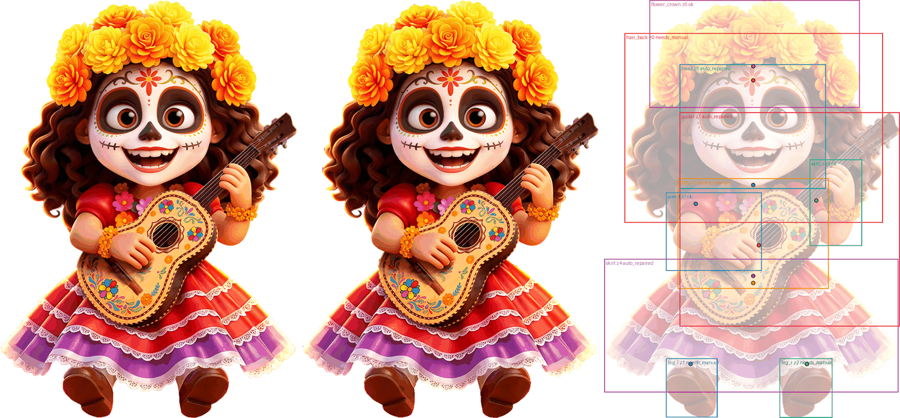
  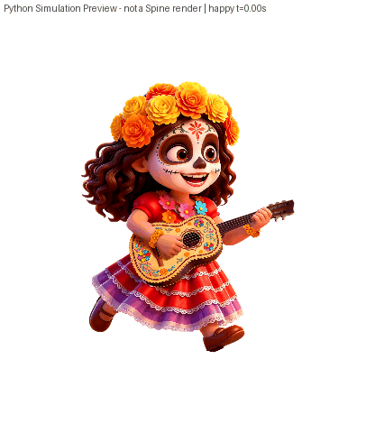
</p>
<p align="center"><sub>左：原圖／分層後重組／部件外框與 pivot。右：Happy 動畫（Python Simulation Preview，不是 Spine 算圖）。</sub></p>

## 目錄

- [效果展示](#效果展示)
- [快速開始：安裝 Claude Skill](#快速開始安裝-claude-skill)
- [流程](#流程)
- [架構](#架構)
- [測試](#測試)
- [輸出](#輸出)
- [CLI（開發與除錯）](#cli開發與除錯)
- [限制與已知問題](#限制與已知問題)
- [開發者](#開發者)

## 效果展示

以下圖片都是 `c2s` 實際輸出，放在 `docs/generalization/<案例>/`。

### 1. 拆成透明分層

Agent 看 `grid_overlay.png`（原圖加座標格線）寫出 `parts.json`，`c2s` 依此切出每個部件。檢查圖三欄依序是原圖、圖層重組（洋紅＝沒有分配到部件的像素）、部件外框與 pivot，外框標籤寫著前後順序與補圖狀態（`ok`、`auto_repaired`、`needs_manual`）。


`人.png` 切成 10 個部件：hair_back、leg_l、leg_r、body、skirt、head、flower_crown、guitar、arm_l、arm_r。圖層重組與原圖的差異 `recompose_mae` 為 0.0014。

### 2. 骨架與動畫

骨架由部件位置推算，產生 Idle（2.0 秒）與 Happy（2.4 秒）兩段循環動畫。下圖上排是原圖、骨架初始姿勢算圖、骨架（藍點＝pivot、紅＝骨頭方向、灰＝父子關係），下排是 Idle 與 Happy 的關鍵影格。

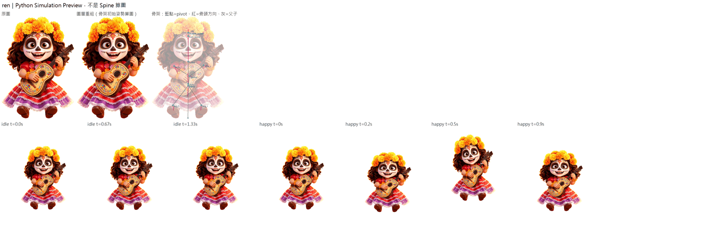

| 人物 拷贝（抱吉他） | 预中奖（捧花） |
|---|---|
|  | 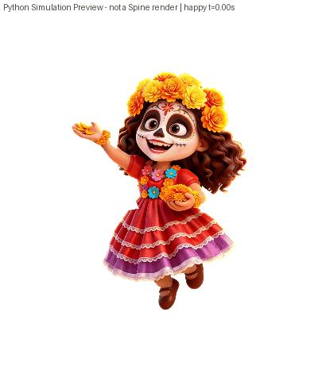 |

預覽 GIF 都是 **Python Simulation Preview**：用自寫的骨架求值器算出來的，不是 Spine 算圖。

### 3. 逐格品質檢查

`c2s refine` 逐格檢查破洞、關節縫隙、手與道具分開、穿插、補圖草稿露出，發現問題就降低該骨頭的動作幅度後重跑，最多 3 輪。`visual_check.png` 把 Happy／Idle 關鍵影格與接觸點畫在一起：實心點跟著手臂、空心圈跟著道具，點在圈中央表示手沒有離開吉他。

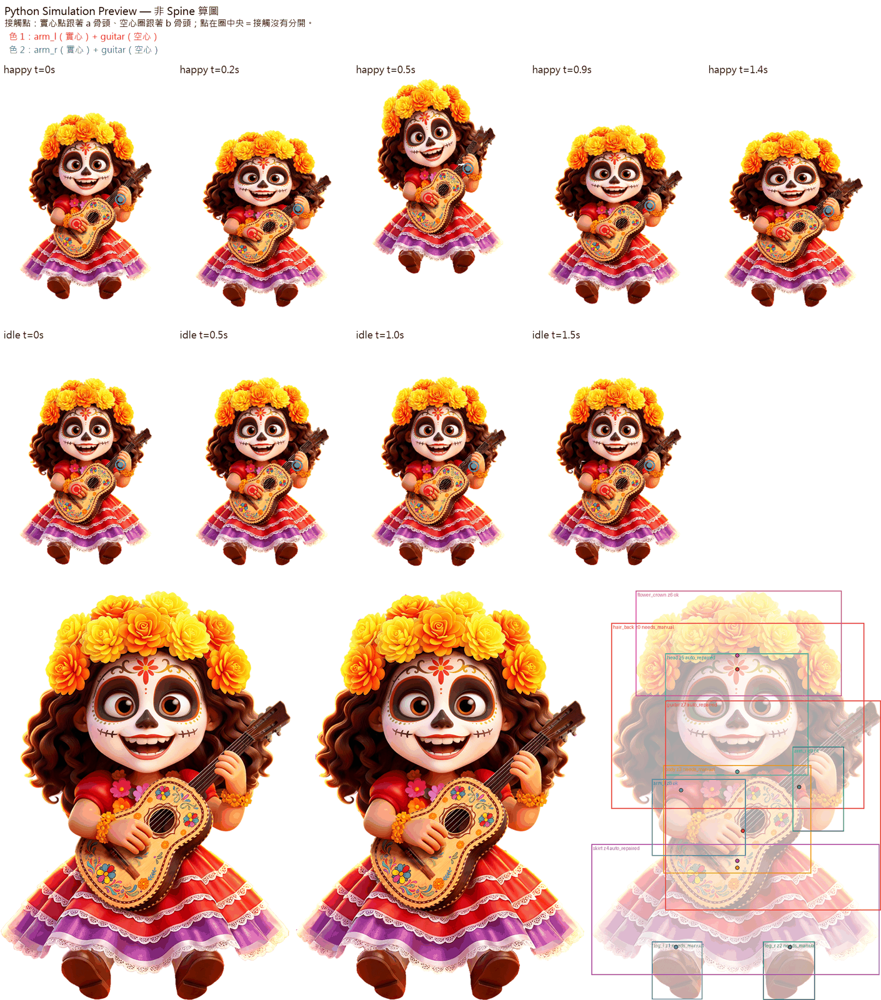

### 4. 人工補畫清單

被遮住的區域只做 OpenCV 邊緣延伸，結果只當草稿。被大面積遮擋、或補得不可靠又會在動畫中露出的部件，列為人工補畫，並附三格對照圖：原圖範圍、目前圖層（洋紅＝自動補上的區域）、動畫中露出最多的那一格。

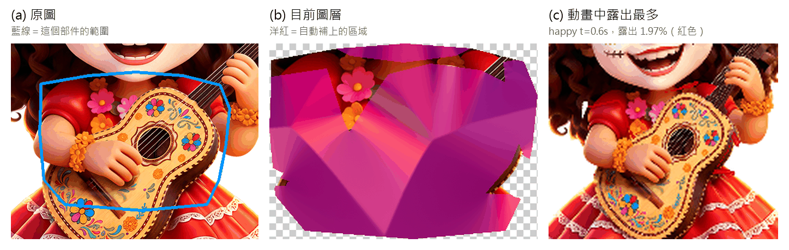

`人.png` 的 body 被吉他擋住 87%，所以列為需人工補畫。補畫完成後交給 Claude，或執行 `c2s prepare --replace body=fixed_body.png`，重跑後動畫會自動放寬原本為了遮草稿而縮小的動作。

### 5. 陌生角色

同一套流程套用在沒看過的角色上（圖片來自 Wikimedia Commons，CC BY-SA）。等級依 `docs/GENERALIZATION_TEST_MATRIX.md` 的凍結規則判定：

| A 正面 Q 版（PARTIAL） | B 3/4 側面長裙（PARTIAL） | H2 拿夾板（PARTIAL） | N3 握拳伸向鏡頭（PARTIAL） |
|---|---|---|---|
| 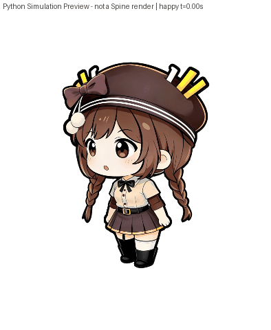 | 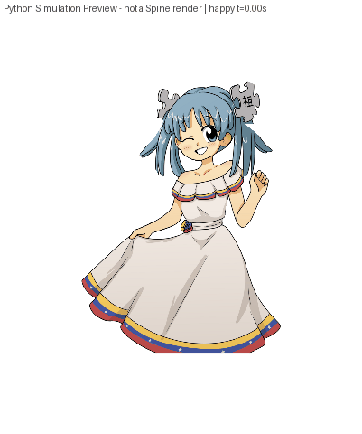 | 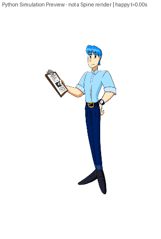 | 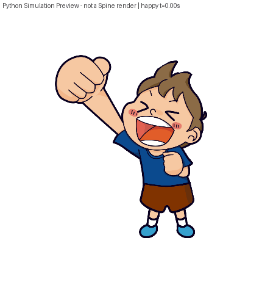 |

PARTIAL 表示分層、骨架、動畫都產生了，但仍有部件要人工補畫或有小瑕疵。完整結果見[測試](#泛化測試陌生角色)。

## 快速開始：安裝 Claude Skill

需要：Claude Code、Python 3.11 以上（`python --version` 確認）、第一次使用時可連網（下載 numpy、Pillow、OpenCV）。不需要 API Key 或付費服務。

1. 解壓 `character-to-spine-skill-v1.1.0.zip`，得到 `character-to-spine/` 資料夾。
2. 放到下列其中一處：
   - 只給某個專案用：`<專案>\.claude\skills\character-to-spine\`
   - 所有專案都能用：`%USERPROFILE%\.claude\skills\character-to-spine\`（macOS／Linux：`~/.claude/skills/character-to-spine/`）

   ```powershell
   Expand-Archive character-to-spine-skill-v1.1.0.zip -DestinationPath .claude\skills
   ```
3. 把角色圖片放進專案資料夾，啟動 Claude Code，說一句話即可，例如：

   > 請將 hero.png 拆補圖、建立骨架，製作 Idle／Happy 動畫並輸出結果。

   也可以用 `/character-to-spine hero.png`。

Claude 會自己分析角色、寫部件描述、執行切圖到輸出的全部步驟，最後回報狀態、輸出位置與需要人工補畫的部件。你不需要執行任何 Python 指令。第一次使用時，Skill 會在自己的資料夾建立 `.venv` 安裝執行環境（約 1～3 分鐘），之後不再重裝。解除安裝就是刪掉 `character-to-spine/` 資料夾。

人工補畫好某個部件後，把 PNG 交給 Claude，說「用 fixed_body.png 取代 body」即可匯回並重新產生動畫。

### 完整版 Spine（選用）

建立 `.spine` 需要 Spine Essential 或 Professional。設定環境變數 `SPINE_EXE` 指向 `Spine.com` 後，同樣的流程會一併建立 `.spine` 專案。只有試用版或沒有安裝時，這一項標示為 BLOCKED，其餘輸出照常產生。輸出的 Spine JSON 可以用 Spine Editor 的「匯入資料」開啟。

## 流程

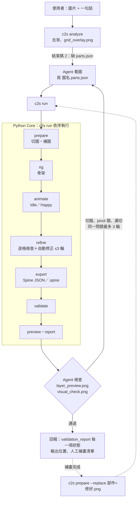

| 步驟 | 誰做 | 產物 |
|---|---|---|
| 分析 | `c2s analyze` | `source_rgba.png`、`grid_overlay.png`；沒有 parts.json 時結束碼 2 並輸出範本 |
| 判斷部件 | Agent（看圖） | 圖片旁的 `<圖名>.parts.json`：部件多邊形、前後順序、pivot、`attach`（手與道具）、`absent`、`role: ground`（影子） |
| 切圖與補圖 | `c2s prepare` | `layers/*.png`、`metadata.json`；依遮擋比例分級：自動補、補了但不可靠、需人工 |
| 骨架 | `c2s rig` | `rig.json`；由部件位置推算骨頭，單手持物時道具掛在手下，雙手抱持時手掛在道具下 |
| 動畫 | `c2s animate` | `animations.json`；Idle 與 Happy 模板，依角色高度縮放、左右對稱、頭髮與裙擺有次要動作 |
| 品質檢查 | `c2s refine` | `quality/quality_report.json`、`tuning.json`、異常影格；修不掉的標 BLOCKED |
| 輸出 | `c2s export` | `spine/character.json`（Spine 4.3）、`spine/images/`；有完整版 Spine 時另有 `.spine` |
| 驗證 | `c2s validate` | `validation_report.json`：每個項目 PASS／FAIL／BLOCKED／NOT_TESTED |
| 預覽與報告 | `c2s preview` | GIF 預覽、`report/visual_check.png`、`report/repair_priority.md`、補畫三格對照圖 |

結束碼：`0` 完成（各項狀態仍以 `validation_report.json` 為準）、`1` 失敗（看 `c2s_error.log`）、`2` 需要補資料後接續、`3` 宣告超出支援範圍（`unsupported`）。

## 架構

```
Agent（Skill）       看圖 → 寫 parts.json → 檢視 layer_preview / visual_check → 修正
                                  │
                                  ▼
Python Core（c2s）   analyze → prepare → rig → animate → refine → export → validate → preview
                                  │
                                  ▼
Spine CLI（完整版）            JSON → .spine → 匯出回 JSON 比對
```

語意判斷（哪裡是頭、手）只發生在 Agent 層。Python 只處理資料，不做語意辨識，可以獨立執行與測試。Skill 內附啟動器與 wheel，不依賴本專案的 `.venv`。

### 模組（`src/character_to_spine/`）

| 檔案 | 職責 |
|---|---|
| `cli.py` | 指令解析、結束碼、錯誤紀錄 `c2s_error.log` |
| `pipeline.py` | 工作目錄解析、`run` 串接全部步驟 |
| `analyzer.py` | 讀圖、去背、座標格線圖、`parts.json` 檢查 |
| `image_processor.py` | 切圖、遮擋分級修補、單一部件重做與替換、修補任務、檢查圖 |
| `providers/` | 修補函式介面 `repair(rgb, unknown) -> rgb`，目前只有 OpenCV（Telea）實作 |
| `rig_builder.py` | preset、由 metadata 推算骨頭、附件與持物階層 |
| `animation_builder.py` | Idle／Happy 模板（依 role 查表、乘上 motion） |
| `quality.py` | 逐格品質檢查（破洞、縫隙、接觸、穿插、草稿露出）與自我修正 |
| `spine_exporter.py` | Spine JSON 組裝、Spine CLI 匯入與往返驗證 |
| `preview.py` | 骨架求值器：初始姿勢算圖、Python Simulation Preview |
| `validator.py` | 檢查實際輸出，產生 `validation_report.json` |
| `report.py` | 修補優先順序、補畫三格對照圖、視覺驗收總覽 |

### 工作目錄

每個角色一個目錄 `output/<圖名>/`，每一步讀前一步的檔案、寫自己的檔案，可以從任何一步接續：

`source_rgba.png`、`grid_overlay.png`、`analysis.json`、`parts.json` → `layers/`、`metadata.json`、`missing_parts.json`、`repair_tasks.md`、`layer_preview.png` → `rig.json` → `animations.json` → `quality/`、`tuning.json` → `spine/character.json`、`spine/images/`、`spine/character.spine`（完整版） → `validation_report.json` → `preview/*.gif`、`report/`

| 位置 | 內容 | 可刪除 |
|---|---|---|
| 圖片旁：`character.png`、`character.parts.json`、遮罩、`character.overrides/` | 永久素材（正式部件描述、人工修補圖） | 否 |
| `output/<圖片檔名>/` | 全部產物 | 可以，`c2s run character.png` 會重建出相同結果 |

### Repo 結構

| 位置 | 內容 |
|---|---|
| `src/character_to_spine/` | Python Core（`c2s`） |
| `skills/character-to-spine/` | Skill 正本：`SKILL.md`、`references/parts-format.md`、啟動器 `scripts/c2s.py` |
| `tests/` | pytest；`synthetic.py` 產生每個部件真實範圍已知的合成角色 |
| `examples/` | `synthetic/` 合成角色、`real/` 開發參考角色、`generalization/` 陌生角色（含來源與授權 `manifest.json`）、`acceptance/` 新使用者驗收圖 |
| `scripts/` | `build_skill.py`（打包 Skill）、`generalization.py`（泛化測試執行器）、`acceptance.py`（新使用者驗收）、`package_deliverables.py`、`make_slides.py` 等 |
| `docs/` | 架構、決策（`DECISIONS.md`）、已知問題、測試結果與各案例的證據圖 |
| `openspec/` | 規格與變更紀錄 |

## 測試

狀態只用 PASS／FAIL／BLOCKED／NOT_TESTED，每一筆都對應實際執行的指令與輸出。完整紀錄見 `docs/TEST_RESULTS.md`。

### 自動化測試

```powershell
.venv\Scripts\python.exe -m pytest -q
```

目前 **153 passed**。測試用 `tests/synthetic.py` 產生的合成角色，每個部件的真實範圍已知，所以能直接比對位置。修正 bug 時都先寫出在修正前會失敗的回歸測試。

| 測試檔 | 涵蓋範圍 |
|---|---|
| `test_analyzer.py` | 去背、`parts.json` 格式檢查、缺少部件、圖片旁的 parts.json 為正式來源 |
| `test_image_processor.py` | 圖層位置、重組等於原圖、遮擋分級、單一部件重做、`--replace` 替換 |
| `test_rig_animation.py` | 骨頭跟隨 pivot、圖層順序、Happy 內容、循環首尾相接、左右對稱、幅度隨身高縮放 |
| `test_pose_aware_motion.py` | 持物階層、影子留在地上、需人工草稿不露出 |
| `test_quality.py` | 破洞、關節縫隙、接觸分離、穿插、草稿露出、自我修正的確定性與不過度縮小 |
| `test_export_validate.py` | Spine JSON 結構、鍵名對照官方 4.3 匯出檔、驗證器能抓到被破壞的輸出、試用版標為 BLOCKED |
| `test_cli.py` | 分步執行、一次跑完、結束碼、錯誤紀錄 |
| `test_scope.py` | `unsupported`（結束碼 3）與 `absent` |
| `test_generalization.py`、`test_visual_report.py`、`test_delivery.py` | 泛化執行器、補畫報告、交付打包 |

驗證器本身也做過「改壞驗證」：在暫存複本中逐一改壞 6 處程式，對應的測試全部抓到（見 `docs/TEST_RESULTS.md`）。

### 輸出驗證（`validation_report.json`）

每次 `c2s run` 都檢查實際輸出。四個開發參考角色（`examples/real/`）目前的結果：

| 檢查項目 | 內容 | 人 | 转场2 | 人物 拷贝 | 预中奖 |
|---|---|---|---|---|---|
| bones | 骨頭階層 | PASS | PASS | PASS | PASS |
| slots | 插槽與附件 | PASS | PASS | PASS | PASS |
| image_references | 圖片存在、尺寸、內容 | PASS | PASS | PASS | PASS |
| animations | Idle／Happy 結構 | PASS | PASS | PASS | PASS |
| setup_pose | 骨架初始姿勢算圖與原圖比對 | PASS | PASS | PASS | PASS |
| animation_quality | 逐格品質檢查 | PASS | PASS | PASS | PASS |
| manual_repairs | 人工補畫 | BLOCKED | BLOCKED | BLOCKED | BLOCKED |
| spine_import | 建立 `.spine` | BLOCKED | BLOCKED | BLOCKED | BLOCKED |
| spine_roundtrip、spine_editable | Spine 往返、Editor 可編輯 | NOT_TESTED | NOT_TESTED | NOT_TESTED | NOT_TESTED |

`manual_repairs` BLOCKED 是因為被遮擋的部件需要人工補畫；`spine_import` BLOCKED 是因為這台機器只有 Spine 試用版。

### 新使用者驗收

`scripts/acceptance.py` 在 repo 外建立空資料夾，照本 README 的步驟解壓 Skill zip，放入一張沒參與開發的圖（`examples/acceptance/music_fan.png`，CC0），用全新的 `claude -p` 下一句話。自然語言、`/character-to-spine` slash 指令、最終 zip 重驗三次都通過：Skill 被觸發、Agent 自己寫 parts.json、`c2s` 由 Skill 自己的 `.venv` 執行、沒有讀到不該讀的檔、用中文回報。紀錄在 `docs/acceptance/`。

### 泛化測試（陌生角色）

`scripts/generalization.py` 對每張圖開一個全新的 Claude Code session，只給一句話與圖片，在只有 Skill 的沙盒中執行。門檻在執行前凍結，之後每次變更都登記在 `examples/generalization/manifest.json`。

| 測試集 | 用途 | PASS | 可處理（PASS 或 PARTIAL） |
|---|---|---|---|
| 開發集 A–E | 用來改過程式，不是泛化證據 | 0/5 | 4/5 |
| 保留集 H1–H4 | 修改完成後才第一次執行 | 0/4 | 2/4 |
| 保留集 N1–N4 | v1.0 修改完成後預登記、第一次執行 | 0/4 | 2/4 |

目前沒有一種角色類型能完全自動完成（PASS），主因是被遮擋的部件一定要人工補畫。每個案例的分層預覽、驗收圖、Happy 預覽、異常影格與 Skill session 紀錄都在 `docs/generalization/<案例>/`，判定細節見 `docs/GENERALIZATION_TEST_MATRIX.md` 與 `docs/SKILL_V1_REPORT.md`。

## 輸出

`output/<圖片檔名>/`：

| 檔案 | 內容 |
|---|---|
| `layers/*.png`、`metadata.json` | 透明分層 PNG 與每個部件的位置、尺寸、pivot、前後順序 |
| `layer_preview.png` | 原圖、圖層重組、部件標示三欄並排的檢查圖 |
| `missing_parts.json`、`repair_tasks.md` | 缺少的部件與需要人工修補的圖層，附接續指令 |
| `spine/character.json`、`spine/images/` | Spine JSON 與圖片（Spine 4.3 格式，`--spine-version` 可改） |
| `spine/character.spine` | 只有完整版 Spine 可用時才會產生 |
| `validation_report.json` | 每個檢查項目的 PASS／FAIL／BLOCKED／NOT_TESTED |
| `quality/quality_report.json`、`quality/round_N/*.png` | 逐格品質檢查、每輪自動修正的紀錄與異常影格 |
| `tuning.json` | 自動修正後各骨頭的動作幅度係數 |
| `report/` | 修補優先順序 `repair_priority.md`、每個部件的三格對照圖、視覺驗收總覽 `visual_check.png` |
| `preview/*_python_simulation_preview.gif` | 用 Python 模擬的動畫預覽，**不是** Spine 算圖 |

## CLI（開發與除錯）

```powershell
# 1. 分析：沒有 parts.json 時結束碼 2，並輸出範本與座標格線圖
c2s analyze character.png

# 2. 看 output\character\grid_overlay.png，在圖片旁寫 character.parts.json
#    格式見 skills/character-to-spine/references/parts-format.md

# 3. 一次跑完
c2s run character.png --motion happy
```

也可以分步執行，後面的指令會接續同一個工作目錄：

```powershell
c2s analyze character.png
c2s prepare
c2s rig --preset humanoid-chibi
c2s animate --motion happy
c2s refine            # 逐格品質檢查＋自動修正，結束時 export
c2s validate
c2s preview
```

人工修補某個部件後匯回（存到圖片旁的 `character.overrides/`，之後重建都會沿用）：

```powershell
c2s prepare --replace arm_l=fixed_arm.png
```

## 限制與已知問題

- 部件辨識靠 Agent 看圖，Python 本身不做語意辨識；邊界不準時要修正 `parts.json` 或改用遮罩。
- 被遮擋的區域只做 OpenCV 邊緣延伸，不使用任何 AI 補圖。以下情況列為人工修補任務：
  - 大面積遮擋（超過 35%）。
  - 實測為不可靠（紋理補不回來或輪廓靠猜），而且在動畫中露出的補圖。
- 自動修正只會降低動作幅度，不會修改部件範圍；修不掉的問題標成 BLOCKED，並附上異常影格。需人工的草稿在補畫前不讓它露出，所以有些手臂動作偏小，補畫匯回後會自動放寬。
- Happy 是站姿跳躍模板。坐姿、跑步等姿勢只剩整體跳動。
- 四肢碰到其他部件（叉腰、手貼身體）時，碰巧圍出的背景仍可能被誤判為破洞或縫隙。
- 第一版只支援人形／Q 版骨架；沒有 Mesh、IK、物理、表情切換。
- 沒有完整版 Spine 時，`.spine` 的建立與 Editor 內可編輯性都無法驗證。

完整清單見 `docs/KNOWN_ISSUES.md`。

## 開發者

```powershell
uv venv .venv --python 3.11
.venv\Scripts\python.exe -m ensurepip
.venv\Scripts\python.exe -m pip install -e ".[dev]"
.venv\Scripts\python.exe -m pytest -q            # 回歸測試
.venv\Scripts\python.exe scripts\build_skill.py  # 產生 dist\character-to-spine\ 與 Skill zip
```

`build_skill.py` 把 Python Core 打成 wheel 放進 Skill 的 `core/`，再壓成 zip。在本專案用 Claude Code 測 Skill 時，把 `dist\character-to-spine\` 複製到 `.claude\skills\`。

重現泛化測試：

```powershell
.venv\Scripts\python.exe scripts\generalization.py skill <案例>   # Skill 實測（會開 claude -p）
.venv\Scripts\python.exe scripts\generalization.py run A B C D E ren zc2 H1 H2 H3 H4
.venv\Scripts\python.exe scripts\generalization.py report
```

文件：

| 文件 | 內容 |
|---|---|
| `docs/ARCHITECTURE.md` | 架構摘要 |
| `docs/DECISIONS.md` | 設計決策與理由 |
| `docs/TEST_RESULTS.md` | 測試執行紀錄與 spec scenario 對照 |
| `docs/SKILL_V1_REPORT.md` | Skill v1.0 實測報告 |
| `docs/GENERALIZATION_TEST_REPORT.md`、`docs/GENERALIZATION_TEST_MATRIX.md` | 泛化測試報告與判定矩陣 |
| `docs/KNOWN_ISSUES.md` | 已知問題 |
| `openspec/` | 規格（`openspec/specs/`）與變更（`openspec/changes/`） |
