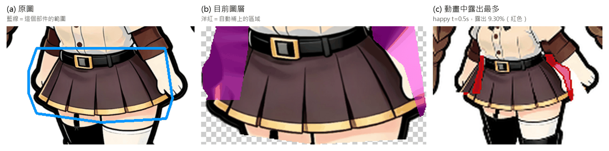
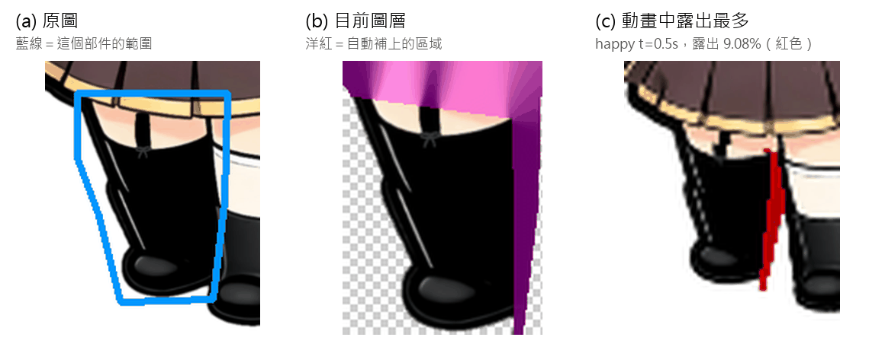
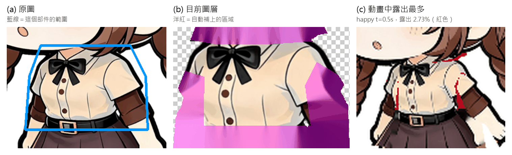
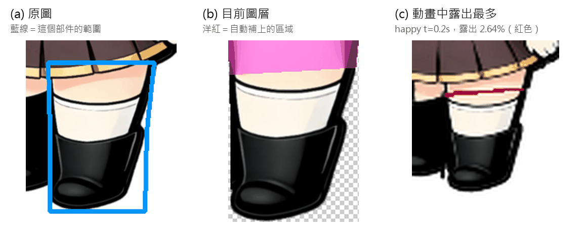
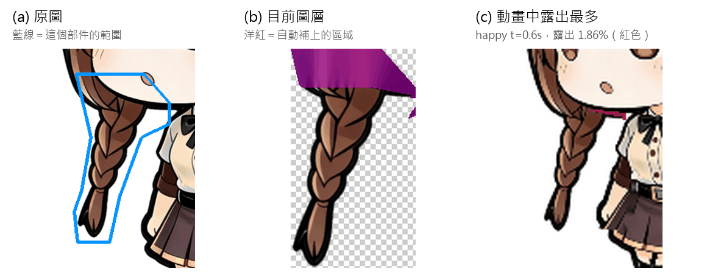
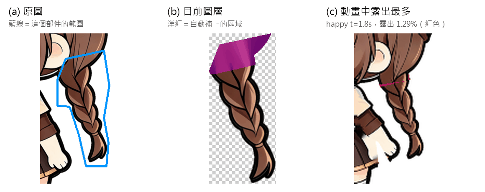

# 補畫優先順序：work

露出量是 Python Simulation Preview 的量測（非 Spine 算圖）：自動補上的像素在 idle／happy 中實際被看見的量，扣掉初始姿勢的值，除以部件在初始姿勢的面積。取樣：每 0.1 秒加上每個關鍵影格。
優先：高 ≥ 2%；中 0.5%–2%；低 > 0 且 < 0.5%（可保留草稿，目視確認即可）；無露出 = 0（動畫中不會露出，可保留草稿）。
像素是預覽畫布像素（縮放 0.336），括號內換算成原圖像素。

## 需要人工補畫（needs_manual）

| 順位 | 部件 | 優先 | 最大露出 | 露出像素 | 發生於 | hidden_ratio | holdout_error | contour_hidden | 遮擋者 |
|---|---|---|---|---|---|---|---|---|---|
| 1 | `skirt` | 高 | 9.30% | 348（約 3085） | happy t=0.5s | 0.1999 | 0.166 | 0.3172 | arm_l、arm_r |
| 2 | `leg_l` | 高 | 9.08% | 115（約 1020） | happy t=0.5s | 0.3359 | 0.1579 | 0.521 | leg_r、skirt |
| 3 | `body` | 高 | 2.73% | 108（約 961） | happy t=0.5s | 0.4995 | 1.0 | 0.7182 | skirt、arm_l、arm_r、head |
| 4 | `leg_r` | 高 | 2.64% | 47（約 417） | happy t=0.2s | 0.1995 | 0.1681 | 0.2908 | skirt |

### skirt（高）

補畫被 arm_l、arm_r 遮住的區域（約 20% 面積）；動畫中最多露出 9.30%（happy t=0.5s）。若暫不補，可降低 arm_l、arm_r 的 motion（parts.json），讓遮擋者別移開那麼多。補畫時注意：被遮住的輪廓佔 32%，那段外形要看原圖重畫，自動補圖補不出來；紋理延伸誤差 0.166，自動填色會糊，要手繪紋理。

### leg_l（高）

補畫被 leg_r、skirt 遮住的區域（約 34% 面積）；動畫中最多露出 9.08%（happy t=0.5s）。若暫不補，可降低 leg_r、skirt 的 motion（parts.json），讓遮擋者別移開那麼多。補畫時注意：被遮住的輪廓佔 52%，那段外形要看原圖重畫，自動補圖補不出來；紋理延伸誤差 0.1579，自動填色會糊，要手繪紋理。

### body（高）

補畫被 skirt、arm_l、arm_r、head 遮住的區域（約 50% 面積）；動畫中最多露出 2.73%（happy t=0.5s）。若暫不補，可降低 skirt、arm_l、arm_r、head 的 motion（parts.json），讓遮擋者別移開那麼多。補畫時注意：被遮住的輪廓佔 72%，那段外形要看原圖重畫，自動補圖補不出來；紋理延伸誤差 1.0，自動填色會糊，要手繪紋理。

### leg_r（高）

補畫被 skirt 遮住的區域（約 20% 面積）；動畫中最多露出 2.64%（happy t=0.2s）。若暫不補，可降低 skirt 的 motion（parts.json），讓遮擋者別移開那麼多。補畫時注意：被遮住的輪廓佔 29%，那段外形要看原圖重畫，自動補圖補不出來；紋理延伸誤差 0.1681，自動填色會糊，要手繪紋理。

## 自動補但不可靠

| 順位 | 部件 | 優先 | 最大露出 | 露出像素 | 發生於 | hidden_ratio | holdout_error | contour_hidden | 遮擋者 |
|---|---|---|---|---|---|---|---|---|---|
| 1 | `braid_l` | 中 | 1.86% | 32（約 281） | happy t=0.6s | 0.348 | 0.1161 | 0.3111 | body、head |
| 2 | `braid_r` | 中 | 1.29% | 23（約 200） | happy t=1.8s | 0.2822 | 0.1197 | 0.2797 | head |

### braid_l（中）

補畫被 body、head 遮住的區域（約 35% 面積）；動畫中最多露出 1.86%（happy t=0.6s）。若暫不補，可降低 body、head 的 motion（parts.json），讓遮擋者別移開那麼多。補畫時注意：被遮住的輪廓佔 31%，那段外形要看原圖重畫，自動補圖補不出來；紋理延伸誤差 0.1161，自動填色會糊，要手繪紋理。

### braid_r（中）

補畫被 head 遮住的區域（約 28% 面積）；動畫中最多露出 1.29%（happy t=1.8s）。若暫不補，可降低 head 的 motion（parts.json），讓遮擋者別移開那麼多。補畫時注意：被遮住的輪廓佔 28%，那段外形要看原圖重畫，自動補圖補不出來；紋理延伸誤差 0.1197，自動填色會糊，要手繪紋理。

