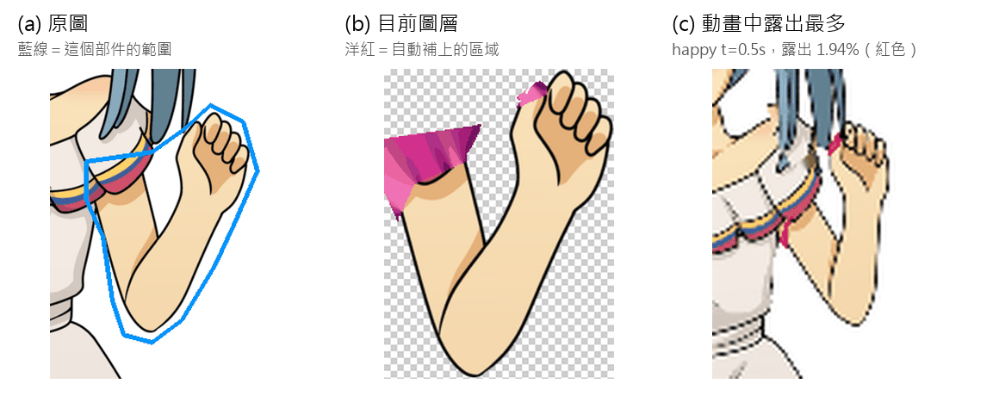
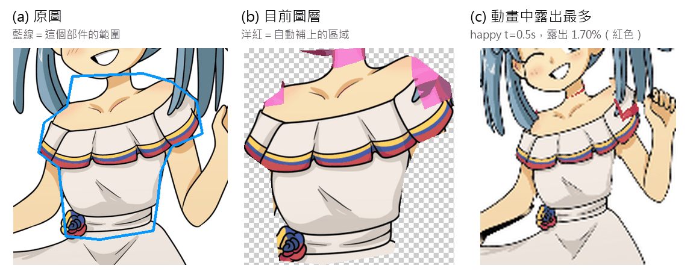
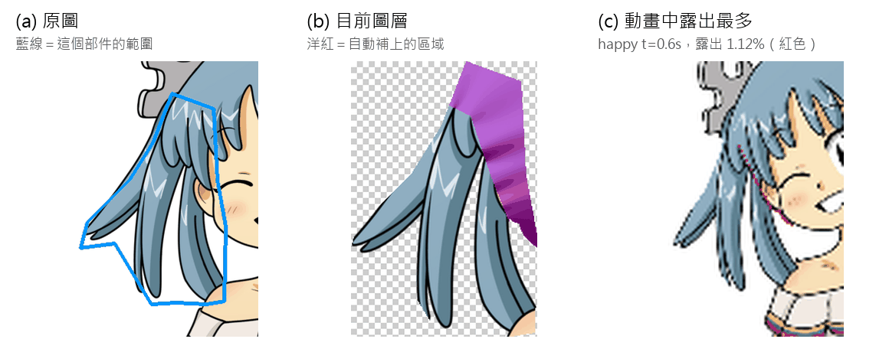
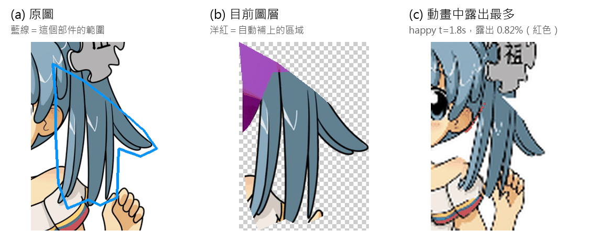

# 補畫優先順序：work

露出量是 Python Simulation Preview 的量測（非 Spine 算圖）：自動補上的像素在 idle／happy 中實際被看見的量，扣掉初始姿勢的值，除以部件在初始姿勢的面積。取樣：每 0.1 秒加上每個關鍵影格。
優先：高 ≥ 2%；中 0.5%–2%；低 > 0 且 < 0.5%（可保留草稿，目視確認即可）；無露出 = 0（動畫中不會露出，可保留草稿）。
像素是預覽畫布像素（縮放 0.274），括號內換算成原圖像素。

## 需要人工補畫（needs_manual）

（無）

## 自動補但不可靠

| 順位 | 部件 | 優先 | 最大露出 | 露出像素 | 發生於 | hidden_ratio | holdout_error | contour_hidden | 遮擋者 |
|---|---|---|---|---|---|---|---|---|---|
| 1 | `arm_r` | 中 | 1.94% | 31（約 408） | happy t=0.5s | 0.1331 | 0.1881 | 0.1994 | body、hair_r |
| 2 | `body` | 中 | 1.70% | 74（約 988） | happy t=0.5s | 0.0717 | 0.1 | 0.2269 | hair_l、hair_r、head |
| 3 | `hair_l` | 中 | 1.12% | 21（約 279） | happy t=0.6s | 0.2906 | 0.1572 | 0.2105 | head |
| 4 | `hair_r` | 中 | 0.82% | 14（約 187） | happy t=1.8s | 0.1553 | 0.081 | 0.153 | head |

### arm_r（中）

補畫被 body、hair_r 遮住的區域（約 13% 面積）；動畫中最多露出 1.94%（happy t=0.5s）。若暫不補，可降低 body、hair_r 的 motion（parts.json），讓遮擋者別移開那麼多。補畫時注意：紋理延伸誤差 0.1881，自動填色會糊，要手繪紋理。

### body（中）

補畫被 hair_l、hair_r、head 遮住的區域（約 7% 面積）；動畫中最多露出 1.70%（happy t=0.5s）。若暫不補，可降低 hair_l、hair_r、head 的 motion（parts.json），讓遮擋者別移開那麼多。補畫時注意：紋理延伸誤差 0.1，自動填色會糊，要手繪紋理。

### hair_l（中）

補畫被 head 遮住的區域（約 29% 面積）；動畫中最多露出 1.12%（happy t=0.6s）。若暫不補，可降低 head 的 motion（parts.json），讓遮擋者別移開那麼多。補畫時注意：紋理延伸誤差 0.1572，自動填色會糊，要手繪紋理。

### hair_r（中）

補畫被 head 遮住的區域（約 16% 面積）；動畫中最多露出 0.82%（happy t=1.8s）。若暫不補，可降低 head 的 motion（parts.json），讓遮擋者別移開那麼多。補畫時注意：紋理延伸誤差 0.081，自動填色會糊，要手繪紋理。

