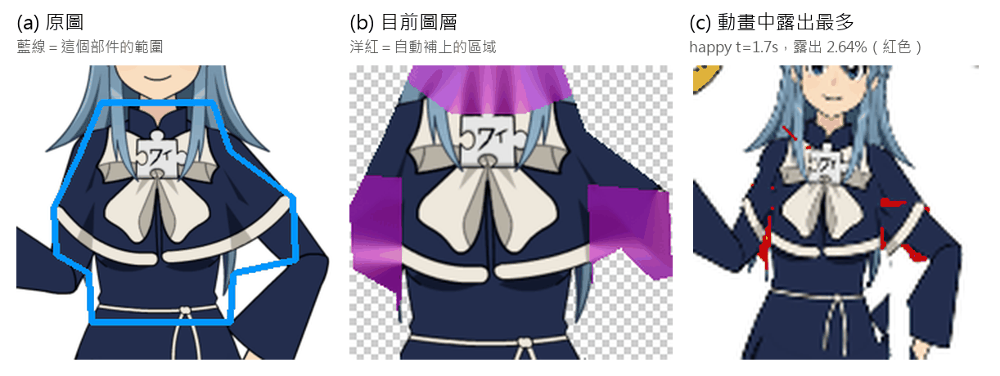
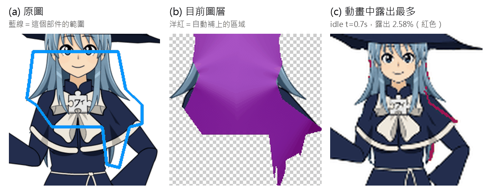
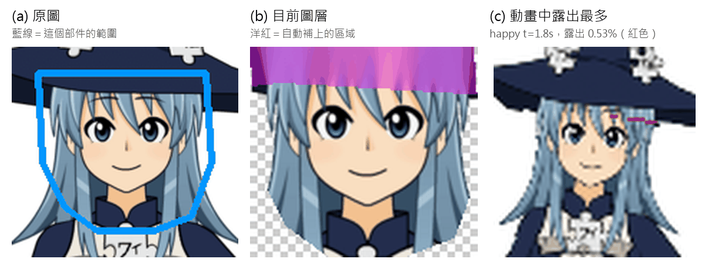

# 補畫優先順序：work

露出量是 Python Simulation Preview 的量測（非 Spine 算圖）：自動補上的像素在 idle／happy 中實際被看見的量，扣掉初始姿勢的值，除以部件在初始姿勢的面積。取樣：每 0.1 秒加上每個關鍵影格。
優先：高 ≥ 2%；中 0.5%–2%；低 > 0 且 < 0.5%（可保留草稿，目視確認即可）；無露出 = 0（動畫中不會露出，可保留草稿）。
像素是預覽畫布像素（縮放 0.381），括號內換算成原圖像素。

## 需要人工補畫（needs_manual）

| 順位 | 部件 | 優先 | 最大露出 | 露出像素 | 發生於 | hidden_ratio | holdout_error | contour_hidden | 遮擋者 |
|---|---|---|---|---|---|---|---|---|---|
| 1 | `body` | 高 | 2.64% | 79（約 546） | happy t=1.7s | 0.2686 | 0.1773 | 0.336 | head、arm_r、arm_l |
| 2 | `hair_back` | 高 | 2.58% | 62（約 425） | idle t=0.7s | 0.9039 | 1.0 | 0.5701 | skirt、body、head、arm_r、arm_l |

### body（高）

補畫被 head、arm_r、arm_l 遮住的區域（約 27% 面積）；動畫中最多露出 2.64%（happy t=1.7s）。若暫不補，可降低 head、arm_r、arm_l 的 motion（parts.json），讓遮擋者別移開那麼多。補畫時注意：被遮住的輪廓佔 34%，那段外形要看原圖重畫，自動補圖補不出來；紋理延伸誤差 0.1773，自動填色會糊，要手繪紋理。

### hair_back（高）

補畫被 skirt、body、head、arm_r、arm_l 遮住的區域（約 90% 面積）；動畫中最多露出 2.58%（idle t=0.7s）。若暫不補，可降低 skirt、body、head、arm_r、arm_l 的 motion（parts.json），讓遮擋者別移開那麼多。補畫時注意：被遮住的輪廓佔 57%，那段外形要看原圖重畫，自動補圖補不出來；紋理延伸誤差 1.0，自動填色會糊，要手繪紋理。

## 自動補但不可靠

| 順位 | 部件 | 優先 | 最大露出 | 露出像素 | 發生於 | hidden_ratio | holdout_error | contour_hidden | 遮擋者 |
|---|---|---|---|---|---|---|---|---|---|
| 1 | `head` | 中 | 0.53% | 9（約 59） | happy t=1.8s | 0.2289 | 0.2011 | 0.3284 | hat |

### head（中）

補畫被 hat 遮住的區域（約 23% 面積）；動畫中最多露出 0.53%（happy t=1.8s）。若暫不補，可降低 hat 的 motion（parts.json），讓遮擋者別移開那麼多。補畫時注意：被遮住的輪廓佔 33%，那段外形要看原圖重畫，自動補圖補不出來；紋理延伸誤差 0.2011，自動填色會糊，要手繪紋理。

