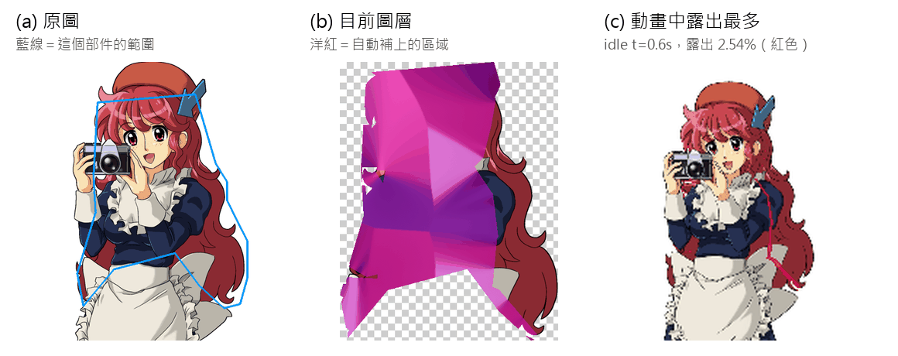
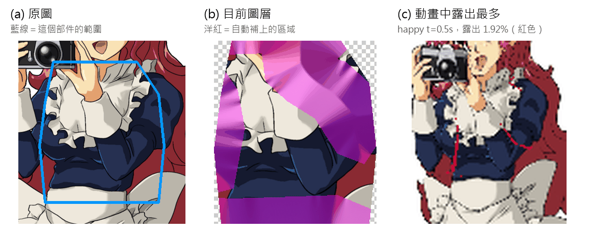
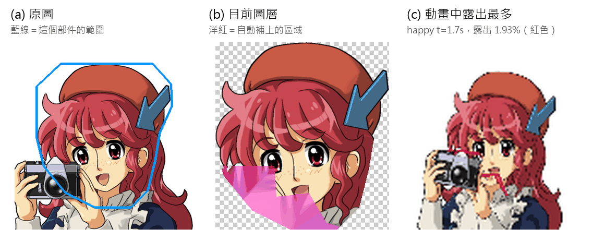
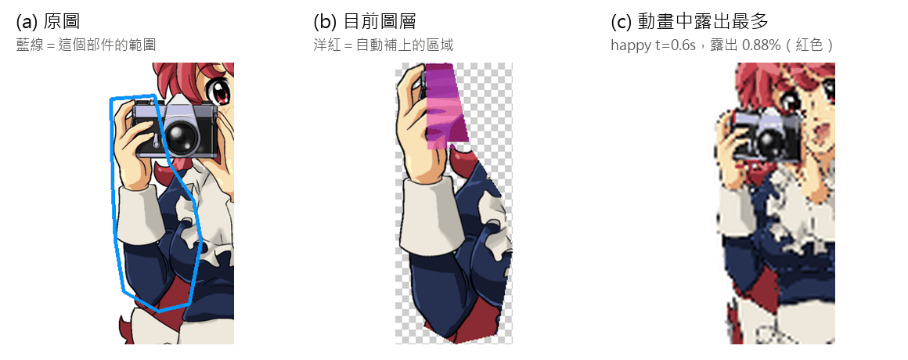

# 補畫優先順序：work

露出量是 Python Simulation Preview 的量測（非 Spine 算圖）：自動補上的像素在 idle／happy 中實際被看見的量，扣掉初始姿勢的值，除以部件在初始姿勢的面積。取樣：每 0.1 秒加上每個關鍵影格。
優先：高 ≥ 2%；中 0.5%–2%；低 > 0 且 < 0.5%（可保留草稿，目視確認即可）；無露出 = 0（動畫中不會露出，可保留草稿）。
像素是預覽畫布像素（縮放 0.237），括號內換算成原圖像素。

## 需要人工補畫（needs_manual）

| 順位 | 部件 | 優先 | 最大露出 | 露出像素 | 發生於 | hidden_ratio | holdout_error | contour_hidden | 遮擋者 |
|---|---|---|---|---|---|---|---|---|---|
| 1 | `hair_back` | 高 | 2.54% | 194（約 3442） | idle t=0.6s | 0.7827 | 1.0 | 0.6377 | body、skirt、head、arm_r、arm_l、camera |
| 2 | `body` | 中 | 1.92% | 59（約 1047） | happy t=0.5s | 0.5598 | 1.0 | 0.651 | skirt、head、arm_r、arm_l、camera |

### hair_back（高）

補畫被 body、skirt、head、arm_r、arm_l、camera 遮住的區域（約 78% 面積）；動畫中最多露出 2.54%（idle t=0.6s）。若暫不補，可降低 body、skirt、head、arm_r、arm_l、camera 的 motion（parts.json），讓遮擋者別移開那麼多。補畫時注意：被遮住的輪廓佔 64%，那段外形要看原圖重畫，自動補圖補不出來；紋理延伸誤差 1.0，自動填色會糊，要手繪紋理。

### body（中）

補畫被 skirt、head、arm_r、arm_l、camera 遮住的區域（約 56% 面積）；動畫中最多露出 1.92%（happy t=0.5s）。若暫不補，可降低 skirt、head、arm_r、arm_l、camera 的 motion（parts.json），讓遮擋者別移開那麼多。補畫時注意：被遮住的輪廓佔 65%，那段外形要看原圖重畫，自動補圖補不出來；紋理延伸誤差 1.0，自動填色會糊，要手繪紋理。

## 自動補但不可靠

| 順位 | 部件 | 優先 | 最大露出 | 露出像素 | 發生於 | hidden_ratio | holdout_error | contour_hidden | 遮擋者 |
|---|---|---|---|---|---|---|---|---|---|
| 1 | `head` | 中 | 1.93% | 66（約 1176） | happy t=1.7s | 0.1433 | 0.1723 | 0.218 | arm_r、camera |
| 2 | `arm_l` | 中 | 0.88% | 12（約 206） | happy t=0.6s | 0.1257 | 0.1076 | 0.1376 | camera |

### head（中）

補畫被 arm_r、camera 遮住的區域（約 14% 面積）；動畫中最多露出 1.93%（happy t=1.7s）。若暫不補，可降低 arm_r、camera 的 motion（parts.json），讓遮擋者別移開那麼多。補畫時注意：紋理延伸誤差 0.1723，自動填色會糊，要手繪紋理。

### arm_l（中）

補畫被 camera 遮住的區域（約 13% 面積）；動畫中最多露出 0.88%（happy t=0.6s）。若暫不補，可降低 camera 的 motion（parts.json），讓遮擋者別移開那麼多。補畫時注意：紋理延伸誤差 0.1076，自動填色會糊，要手繪紋理。

