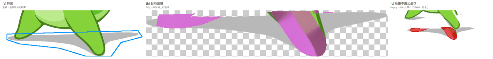
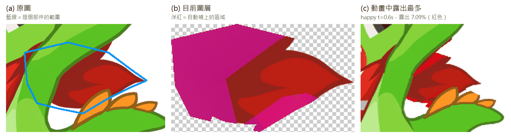
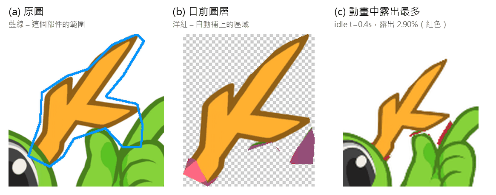
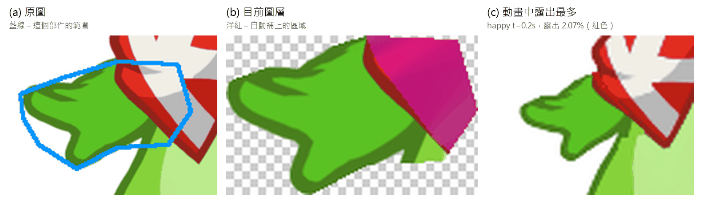
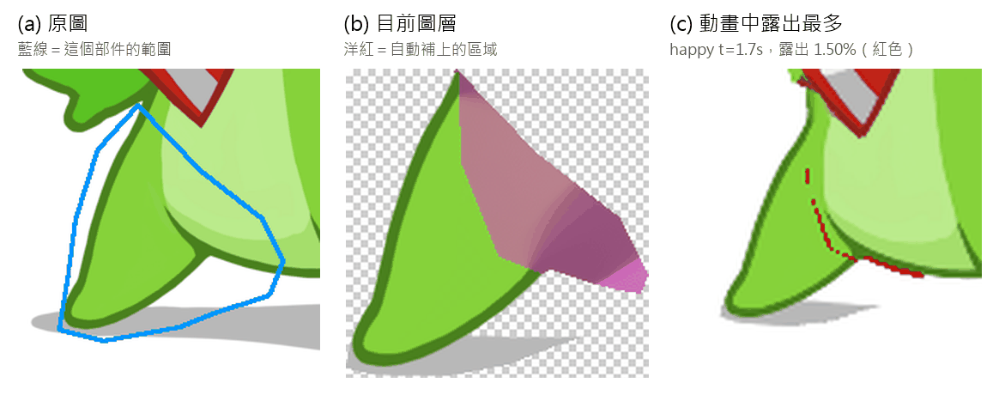
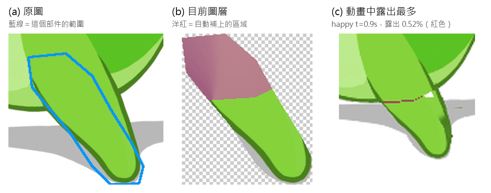
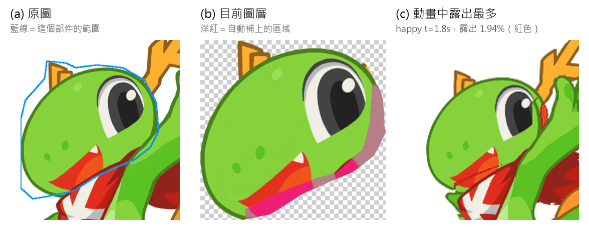
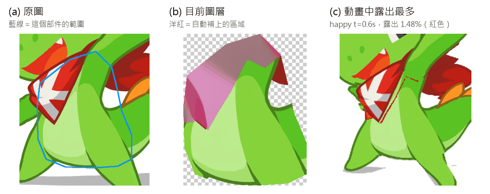
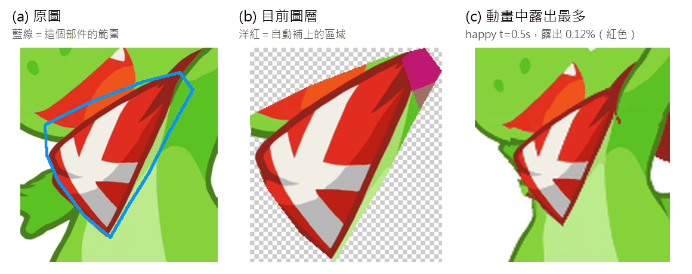

# 補畫優先順序：work

露出量是 Python Simulation Preview 的量測（非 Spine 算圖）：自動補上的像素在 idle／happy 中實際被看見的量，扣掉初始姿勢的值，除以部件在初始姿勢的面積。取樣：每 0.1 秒加上每個關鍵影格。
優先：高 ≥ 2%；中 0.5%–2%；低 > 0 且 < 0.5%（可保留草稿，目視確認即可）；無露出 = 0（動畫中不會露出，可保留草稿）。
像素是預覽畫布像素（縮放 0.417），括號內換算成原圖像素。

## 需要人工補畫（needs_manual）

| 順位 | 部件 | 優先 | 最大露出 | 露出像素 | 發生於 | hidden_ratio | holdout_error | contour_hidden | 遮擋者 |
|---|---|---|---|---|---|---|---|---|---|
| 1 | `shadow` | 高 | 35.04% | 1005（約 5790） | happy t=0.4s | 0.4858 | 0.034 | 0.1939 | tail、leg_l、leg_r |
| 2 | `cape` | 高 | 7.09% | 259（約 1490） | happy t=0.6s | 0.5786 | 1.0 | 0.6445 | tail、body、head、scarf、arm_r |
| 3 | `horn` | 高 | 2.90% | 60（約 347） | idle t=0.4s | 0.1186 | 0.0872 | 0.1261 | head、arm_r |
| 4 | `arm_l` | 高 | 2.07% | 23（約 132） | happy t=0.2s | 0.2814 | 0.0502 | 0.261 | scarf |
| 5 | `leg_l` | 中 | 1.50% | 35（約 202） | happy t=1.7s | 0.3889 | 0.0533 | 0.296 | body、arm_l |
| 6 | `leg_r` | 中 | 0.52% | 11（約 65） | happy t=0.9s | 0.4489 | 0.0594 | 0.4043 | body |

### shadow（高）

補畫被 tail、leg_l、leg_r 遮住的區域（約 49% 面積）；動畫中最多露出 35.04%（happy t=0.4s）。若暫不補，可降低 tail、leg_l、leg_r 的 motion（parts.json），讓遮擋者別移開那麼多。

### cape（高）

補畫被 tail、body、head、scarf、arm_r 遮住的區域（約 58% 面積）；動畫中最多露出 7.09%（happy t=0.6s）。若暫不補，可降低 tail、body、head、scarf、arm_r 的 motion（parts.json），讓遮擋者別移開那麼多。補畫時注意：被遮住的輪廓佔 64%，那段外形要看原圖重畫，自動補圖補不出來；紋理延伸誤差 1.0，自動填色會糊，要手繪紋理。

### horn（高）

補畫被 head、arm_r 遮住的區域（約 12% 面積）；動畫中最多露出 2.90%（idle t=0.4s）。若暫不補，可降低 head、arm_r 的 motion（parts.json），讓遮擋者別移開那麼多。補畫時注意：紋理延伸誤差 0.0872，自動填色會糊，要手繪紋理。

### arm_l（高）

補畫被 scarf 遮住的區域（約 28% 面積）；動畫中最多露出 2.07%（happy t=0.2s）。若暫不補，可降低 scarf 的 motion（parts.json），讓遮擋者別移開那麼多。補畫時注意：被遮住的輪廓佔 26%，那段外形要看原圖重畫，自動補圖補不出來。

### leg_l（中）

補畫被 body、arm_l 遮住的區域（約 39% 面積）；動畫中最多露出 1.50%（happy t=1.7s）。若暫不補，可降低 body、arm_l 的 motion（parts.json），讓遮擋者別移開那麼多。補畫時注意：被遮住的輪廓佔 30%，那段外形要看原圖重畫，自動補圖補不出來。

### leg_r（中）

補畫被 body 遮住的區域（約 45% 面積）；動畫中最多露出 0.52%（happy t=0.9s）。若暫不補，可降低 body 的 motion（parts.json），讓遮擋者別移開那麼多。補畫時注意：被遮住的輪廓佔 40%，那段外形要看原圖重畫，自動補圖補不出來。

## 自動補但不可靠

| 順位 | 部件 | 優先 | 最大露出 | 露出像素 | 發生於 | hidden_ratio | holdout_error | contour_hidden | 遮擋者 |
|---|---|---|---|---|---|---|---|---|---|
| 1 | `head` | 中 | 1.94% | 195（約 1122） | happy t=1.8s | 0.1032 | 0.0869 | 0.3726 | scarf、arm_r |
| 2 | `body` | 中 | 1.48% | 134（約 771） | happy t=0.6s | 0.285 | 0.0668 | 0.3319 | arm_l、head、scarf、arm_r |
| 3 | `scarf` | 低 | 0.12% | 4（約 21） | happy t=0.5s | 0.0616 | 0.0822 | 0.1114 | arm_r |

### head（中）

補畫被 scarf、arm_r 遮住的區域（約 10% 面積）；動畫中最多露出 1.94%（happy t=1.8s）。若暫不補，可降低 scarf、arm_r 的 motion（parts.json），讓遮擋者別移開那麼多。補畫時注意：被遮住的輪廓佔 37%，那段外形要看原圖重畫，自動補圖補不出來；紋理延伸誤差 0.0869，自動填色會糊，要手繪紋理。

### body（中）

補畫被 arm_l、head、scarf、arm_r 遮住的區域（約 28% 面積）；動畫中最多露出 1.48%（happy t=0.6s）。若暫不補，可降低 arm_l、head、scarf、arm_r 的 motion（parts.json），讓遮擋者別移開那麼多。補畫時注意：被遮住的輪廓佔 33%，那段外形要看原圖重畫，自動補圖補不出來。

### scarf（低）

補畫被 arm_r 遮住的區域（約 6% 面積）；動畫中最多露出 0.12%（happy t=0.5s）。可保留草稿，目視確認即可。補畫時注意：紋理延伸誤差 0.0822，自動填色會糊，要手繪紋理。

