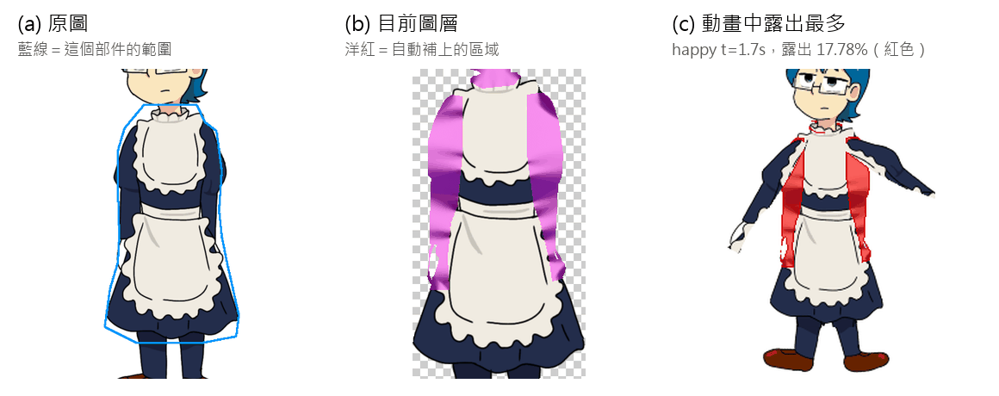
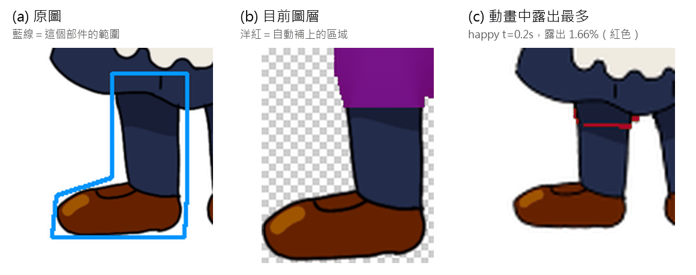

# 補畫優先順序：work

露出量是 Python Simulation Preview 的量測（非 Spine 算圖）：自動補上的像素在 idle／happy 中實際被看見的量，扣掉初始姿勢的值，除以部件在初始姿勢的面積。取樣：每 0.1 秒加上每個關鍵影格。
優先：高 ≥ 2%；中 0.5%–2%；低 > 0 且 < 0.5%（可保留草稿，目視確認即可）；無露出 = 0（動畫中不會露出，可保留草稿）。
像素是預覽畫布像素（縮放 0.492），括號內換算成原圖像素。

## 需要人工補畫（needs_manual）

| 順位 | 部件 | 優先 | 最大露出 | 露出像素 | 發生於 | hidden_ratio | holdout_error | contour_hidden | 遮擋者 |
|---|---|---|---|---|---|---|---|---|---|
| 1 | `body` | 高 | 17.78% | 2311（約 9554） | happy t=1.7s | 0.2552 | 0.0744 | 0.4491 | arm_l、arm_r、head |

### body（高）

補畫被 arm_l、arm_r、head 遮住的區域（約 26% 面積）；動畫中最多露出 17.78%（happy t=1.7s）。若暫不補，可降低 arm_l、arm_r、head 的 motion（parts.json），讓遮擋者別移開那麼多。補畫時注意：被遮住的輪廓佔 45%，那段外形要看原圖重畫，自動補圖補不出來。

## 自動補但不可靠

| 順位 | 部件 | 優先 | 最大露出 | 露出像素 | 發生於 | hidden_ratio | holdout_error | contour_hidden | 遮擋者 |
|---|---|---|---|---|---|---|---|---|---|
| 1 | `leg_l` | 中 | 1.66% | 26（約 108） | happy t=0.2s | 0.2573 | 0.0273 | 0.2654 | body |

### leg_l（中）

補畫被 body 遮住的區域（約 26% 面積）；動畫中最多露出 1.66%（happy t=0.2s）。若暫不補，可降低 body 的 motion（parts.json），讓遮擋者別移開那麼多。補畫時注意：被遮住的輪廓佔 27%，那段外形要看原圖重畫，自動補圖補不出來。

