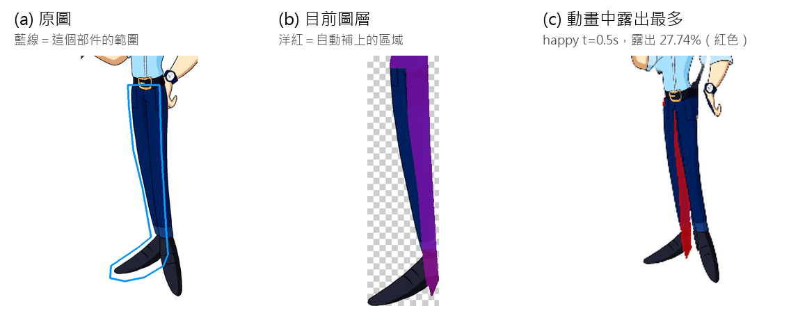
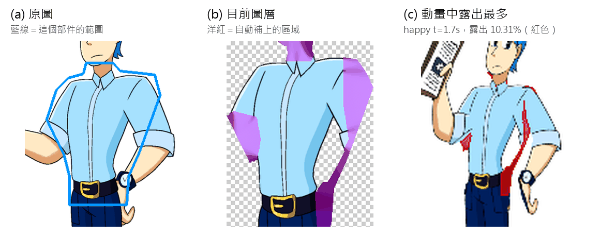
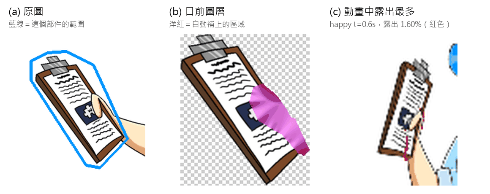

# 補畫優先順序：work

露出量是 Python Simulation Preview 的量測（非 Spine 算圖）：自動補上的像素在 idle／happy 中實際被看見的量，扣掉初始姿勢的值，除以部件在初始姿勢的面積。取樣：每 0.1 秒加上每個關鍵影格。
優先：高 ≥ 2%；中 0.5%–2%；低 > 0 且 < 0.5%（可保留草稿，目視確認即可）；無露出 = 0（動畫中不會露出，可保留草稿）。
像素是預覽畫布像素（縮放 0.325），括號內換算成原圖像素。

## 需要人工補畫（needs_manual）

| 順位 | 部件 | 優先 | 最大露出 | 露出像素 | 發生於 | hidden_ratio | holdout_error | contour_hidden | 遮擋者 |
|---|---|---|---|---|---|---|---|---|---|
| 1 | `leg_l` | 高 | 27.74% | 855（約 8120） | happy t=0.5s | 0.5636 | 1.0 | 0.4209 | leg_r、body |
| 2 | `body` | 高 | 10.31% | 366（約 3474） | happy t=1.7s | 0.253 | 0.0649 | 0.4088 | arm_r、head、arm_l |

### leg_l（高）

補畫被 leg_r、body 遮住的區域（約 56% 面積）；動畫中最多露出 27.74%（happy t=0.5s）。若暫不補，可降低 leg_r、body 的 motion（parts.json），讓遮擋者別移開那麼多。補畫時注意：被遮住的輪廓佔 42%，那段外形要看原圖重畫，自動補圖補不出來；紋理延伸誤差 1.0，自動填色會糊，要手繪紋理。

### body（高）

補畫被 arm_r、head、arm_l 遮住的區域（約 25% 面積）；動畫中最多露出 10.31%（happy t=1.7s）。若暫不補，可降低 arm_r、head、arm_l 的 motion（parts.json），讓遮擋者別移開那麼多。補畫時注意：被遮住的輪廓佔 41%，那段外形要看原圖重畫，自動補圖補不出來。

## 自動補但不可靠

| 順位 | 部件 | 優先 | 最大露出 | 露出像素 | 發生於 | hidden_ratio | holdout_error | contour_hidden | 遮擋者 |
|---|---|---|---|---|---|---|---|---|---|
| 1 | `clipboard` | 中 | 1.60% | 19（約 185） | happy t=0.6s | 0.1949 | 0.2975 | 0.1955 | arm_l |

### clipboard（中）

補畫被 arm_l 遮住的區域（約 19% 面積）；動畫中最多露出 1.60%（happy t=0.6s）。若暫不補，可降低 arm_l 的 motion（parts.json），讓遮擋者別移開那麼多。補畫時注意：紋理延伸誤差 0.2975，自動填色會糊，要手繪紋理。

