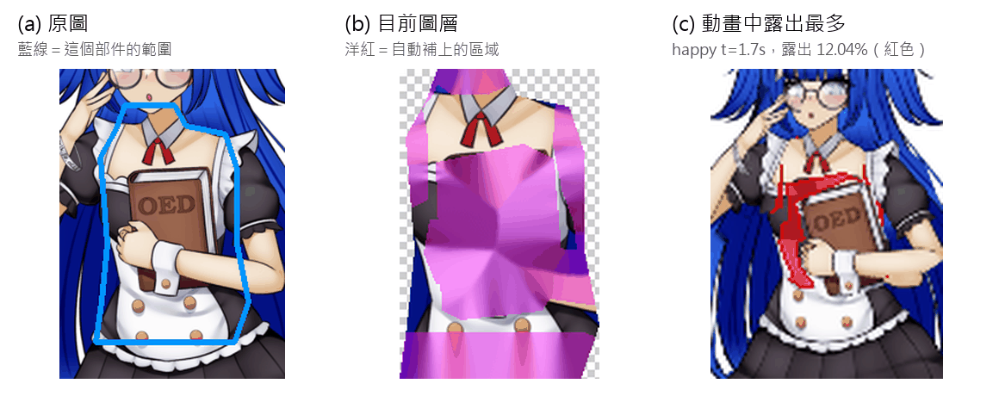
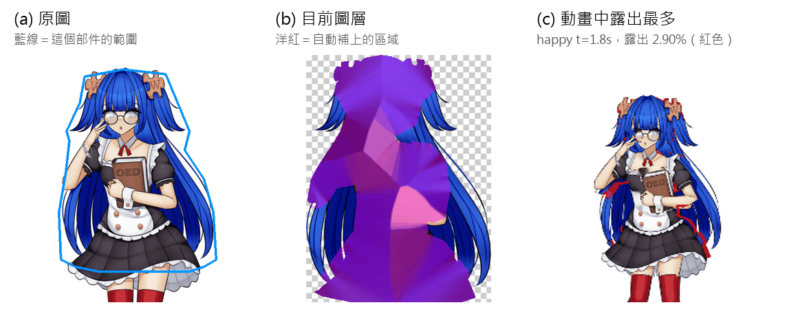
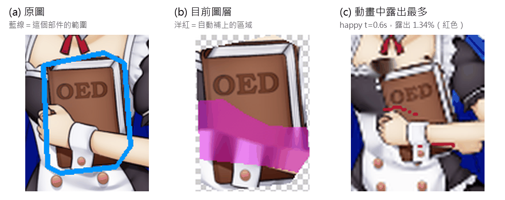
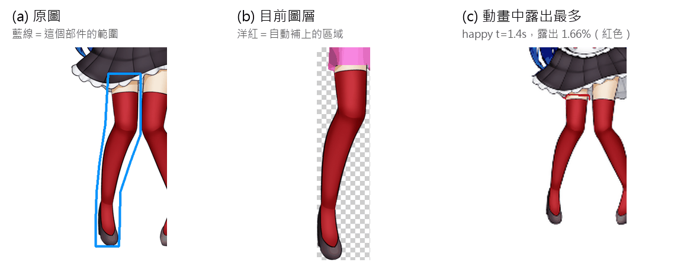
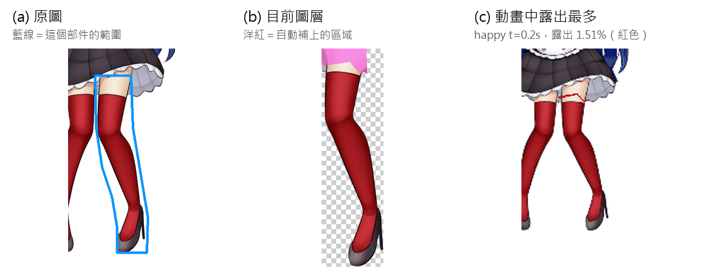
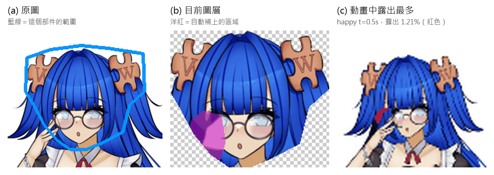

# 補畫優先順序：work

露出量是 Python Simulation Preview 的量測（非 Spine 算圖）：自動補上的像素在 idle／happy 中實際被看見的量，扣掉初始姿勢的值，除以部件在初始姿勢的面積。取樣：每 0.1 秒加上每個關鍵影格。
優先：高 ≥ 2%；中 0.5%–2%；低 > 0 且 < 0.5%（可保留草稿，目視確認即可）；無露出 = 0（動畫中不會露出，可保留草稿）。
像素是預覽畫布像素（縮放 0.381），括號內換算成原圖像素。

## 需要人工補畫（needs_manual）

| 順位 | 部件 | 優先 | 最大露出 | 露出像素 | 發生於 | hidden_ratio | holdout_error | contour_hidden | 遮擋者 |
|---|---|---|---|---|---|---|---|---|---|
| 1 | `body` | 高 | 12.04% | 401（約 2760） | happy t=1.7s | 0.7087 | 1.0 | 0.6545 | skirt、head、book、arm_r、arm_l |
| 2 | `hair_back` | 高 | 2.90% | 414（約 2851） | happy t=1.8s | 0.7616 | 1.0 | 0.2474 | leg_l、leg_r、body、skirt、head、book、arm_r、arm_l |
| 3 | `book` | 中 | 1.34% | 17（約 114） | happy t=0.6s | 0.3566 | 0.1729 | 0.165 | arm_r |

### body（高）

補畫被 skirt、head、book、arm_r、arm_l 遮住的區域（約 71% 面積）；動畫中最多露出 12.04%（happy t=1.7s）。若暫不補，可降低 skirt、head、book、arm_r、arm_l 的 motion（parts.json），讓遮擋者別移開那麼多。補畫時注意：被遮住的輪廓佔 65%，那段外形要看原圖重畫，自動補圖補不出來；紋理延伸誤差 1.0，自動填色會糊，要手繪紋理。

### hair_back（高）

補畫被 leg_l、leg_r、body、skirt、head、book、arm_r、arm_l 遮住的區域（約 76% 面積）；動畫中最多露出 2.90%（happy t=1.8s）。若暫不補，可降低 leg_l、leg_r、body、skirt、head、book、arm_r、arm_l 的 motion（parts.json），讓遮擋者別移開那麼多。補畫時注意：紋理延伸誤差 1.0，自動填色會糊，要手繪紋理。

### book（中）

補畫被 arm_r 遮住的區域（約 36% 面積）；動畫中最多露出 1.34%（happy t=0.6s）。若暫不補，可降低 arm_r 的 motion（parts.json），讓遮擋者別移開那麼多。補畫時注意：紋理延伸誤差 0.1729，自動填色會糊，要手繪紋理。

## 自動補但不可靠

| 順位 | 部件 | 優先 | 最大露出 | 露出像素 | 發生於 | hidden_ratio | holdout_error | contour_hidden | 遮擋者 |
|---|---|---|---|---|---|---|---|---|---|
| 1 | `leg_l` | 中 | 1.66% | 37（約 258） | happy t=1.4s | 0.1364 | 0.1715 | 0.1439 | leg_r、skirt |
| 2 | `leg_r` | 中 | 1.51% | 37（約 253） | happy t=0.2s | 0.1248 | 0.2579 | 0.1376 | skirt |
| 3 | `head` | 中 | 1.21% | 33（約 228） | happy t=0.5s | 0.0725 | 0.1397 | 0.0712 | arm_l |

### leg_l（中）

補畫被 leg_r、skirt 遮住的區域（約 14% 面積）；動畫中最多露出 1.66%（happy t=1.4s）。若暫不補，可降低 leg_r、skirt 的 motion（parts.json），讓遮擋者別移開那麼多。補畫時注意：紋理延伸誤差 0.1715，自動填色會糊，要手繪紋理。

### leg_r（中）

補畫被 skirt 遮住的區域（約 12% 面積）；動畫中最多露出 1.51%（happy t=0.2s）。若暫不補，可降低 skirt 的 motion（parts.json），讓遮擋者別移開那麼多。補畫時注意：紋理延伸誤差 0.2579，自動填色會糊，要手繪紋理。

### head（中）

補畫被 arm_l 遮住的區域（約 7% 面積）；動畫中最多露出 1.21%（happy t=0.5s）。若暫不補，可降低 arm_l 的 motion（parts.json），讓遮擋者別移開那麼多。補畫時注意：紋理延伸誤差 0.1397，自動填色會糊，要手繪紋理。

