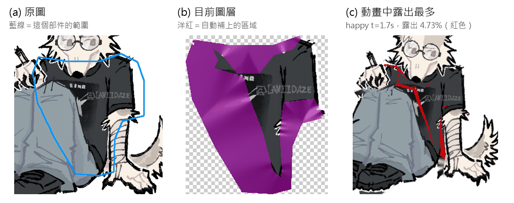
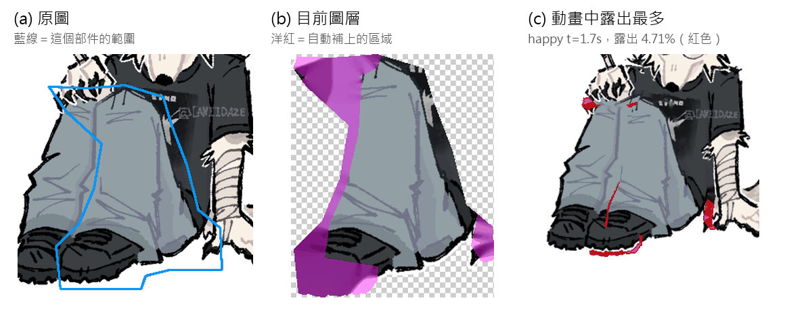
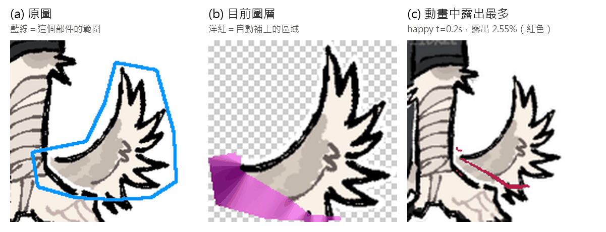
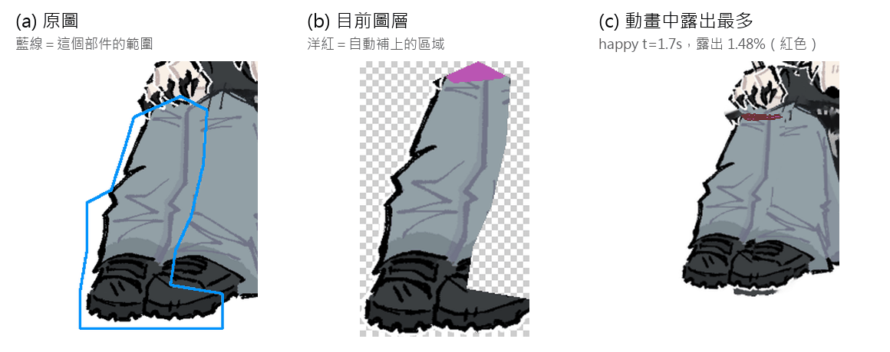
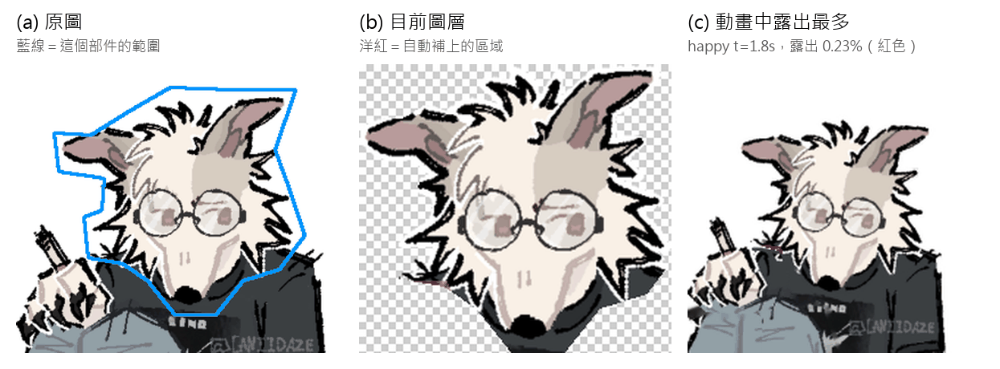

# 補畫優先順序：work

露出量是 Python Simulation Preview 的量測（非 Spine 算圖）：自動補上的像素在 idle／happy 中實際被看見的量，扣掉初始姿勢的值，除以部件在初始姿勢的面積。取樣：每 0.1 秒加上每個關鍵影格。
優先：高 ≥ 2%；中 0.5%–2%；低 > 0 且 < 0.5%（可保留草稿，目視確認即可）；無露出 = 0（動畫中不會露出，可保留草稿）。
像素是預覽畫布像素（縮放 0.651），括號內換算成原圖像素。

## 需要人工補畫（needs_manual）

| 順位 | 部件 | 優先 | 最大露出 | 露出像素 | 發生於 | hidden_ratio | holdout_error | contour_hidden | 遮擋者 |
|---|---|---|---|---|---|---|---|---|---|
| 1 | `body` | 高 | 4.73% | 828（約 1951） | happy t=1.7s | 0.6788 | 1.0 | 0.7771 | head、leg_r、leg_l、arm_l、arm_r |
| 2 | `leg_r` | 高 | 4.71% | 769（約 1814） | happy t=1.7s | 0.2874 | 0.0851 | 0.5159 | leg_l、arm_l、arm_r |
| 3 | `tail` | 高 | 2.55% | 89（約 210） | happy t=0.2s | 0.2073 | 0.2178 | 0.2187 | arm_r |

### body（高）

補畫被 head、leg_r、leg_l、arm_l、arm_r 遮住的區域（約 68% 面積）；動畫中最多露出 4.73%（happy t=1.7s）。若暫不補，可降低 head、leg_r、leg_l、arm_l、arm_r 的 motion（parts.json），讓遮擋者別移開那麼多。補畫時注意：被遮住的輪廓佔 78%，那段外形要看原圖重畫，自動補圖補不出來；紋理延伸誤差 1.0，自動填色會糊，要手繪紋理。

### leg_r（高）

補畫被 leg_l、arm_l、arm_r 遮住的區域（約 29% 面積）；動畫中最多露出 4.71%（happy t=1.7s）。若暫不補，可降低 leg_l、arm_l、arm_r 的 motion（parts.json），讓遮擋者別移開那麼多。補畫時注意：被遮住的輪廓佔 52%，那段外形要看原圖重畫，自動補圖補不出來；紋理延伸誤差 0.0851，自動填色會糊，要手繪紋理。

### tail（高）

補畫被 arm_r 遮住的區域（約 21% 面積）；動畫中最多露出 2.55%（happy t=0.2s）。若暫不補，可降低 arm_r 的 motion（parts.json），讓遮擋者別移開那麼多。補畫時注意：紋理延伸誤差 0.2178，自動填色會糊，要手繪紋理。

## 自動補但不可靠

| 順位 | 部件 | 優先 | 最大露出 | 露出像素 | 發生於 | hidden_ratio | holdout_error | contour_hidden | 遮擋者 |
|---|---|---|---|---|---|---|---|---|---|
| 1 | `leg_l` | 中 | 1.48% | 160（約 377） | happy t=1.7s | 0.0259 | 0.0822 | 0.0688 | arm_l |
| 2 | `head` | 低 | 0.23% | 25（約 59） | happy t=1.8s | 0.0025 | 0.2101 | 0.0 | arm_l |

### leg_l（中）

補畫被 arm_l 遮住的區域（約 3% 面積）；動畫中最多露出 1.48%（happy t=1.7s）。若暫不補，可降低 arm_l 的 motion（parts.json），讓遮擋者別移開那麼多。補畫時注意：紋理延伸誤差 0.0822，自動填色會糊，要手繪紋理。

### head（低）

補畫被 arm_l 遮住的區域（約 0% 面積）；動畫中最多露出 0.23%（happy t=1.8s）。可保留草稿，目視確認即可。補畫時注意：紋理延伸誤差 0.2101，自動填色會糊，要手繪紋理。

