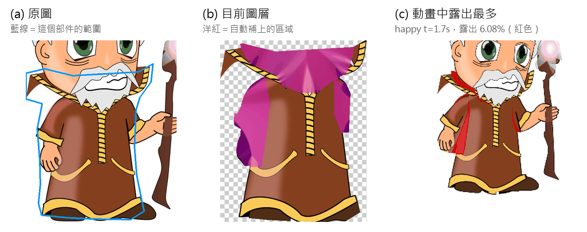
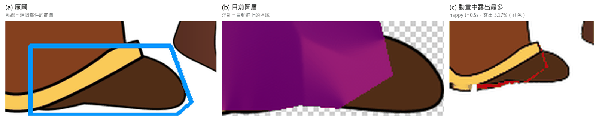
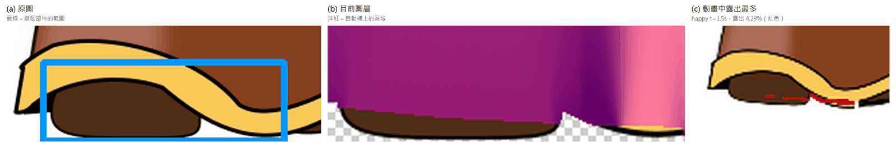
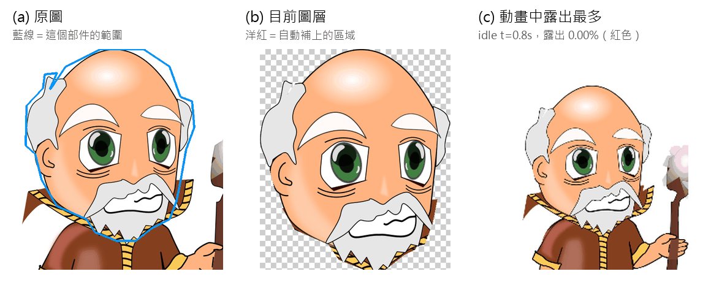

# 補畫優先順序：work

露出量是 Python Simulation Preview 的量測（非 Spine 算圖）：自動補上的像素在 idle／happy 中實際被看見的量，扣掉初始姿勢的值，除以部件在初始姿勢的面積。取樣：每 0.1 秒加上每個關鍵影格。
優先：高 ≥ 2%；中 0.5%–2%；低 > 0 且 < 0.5%（可保留草稿，目視確認即可）；無露出 = 0（動畫中不會露出，可保留草稿）。
像素是預覽畫布像素（縮放 0.376），括號內換算成原圖像素。

## 需要人工補畫（needs_manual）

| 順位 | 部件 | 優先 | 最大露出 | 露出像素 | 發生於 | hidden_ratio | holdout_error | contour_hidden | 遮擋者 |
|---|---|---|---|---|---|---|---|---|---|
| 1 | `body` | 高 | 6.08% | 1188（約 8410） | happy t=1.7s | 0.3371 | 0.1203 | 0.313 | head、arm_l、arm_r |
| 2 | `leg_r` | 高 | 5.17% | 72（約 512） | happy t=0.5s | 0.7591 | 0.0066 | 0.4029 | body |
| 3 | `leg_l` | 高 | 4.29% | 61（約 430） | happy t=1.5s | 0.8619 | 1.0 | 0.5498 | leg_r、body |

### body（高）

補畫被 head、arm_l、arm_r 遮住的區域（約 34% 面積）；動畫中最多露出 6.08%（happy t=1.7s）。若暫不補，可降低 head、arm_l、arm_r 的 motion（parts.json），讓遮擋者別移開那麼多。補畫時注意：被遮住的輪廓佔 31%，那段外形要看原圖重畫，自動補圖補不出來；紋理延伸誤差 0.1203，自動填色會糊，要手繪紋理。

### leg_r（高）

補畫被 body 遮住的區域（約 76% 面積）；動畫中最多露出 5.17%（happy t=0.5s）。若暫不補，可降低 body 的 motion（parts.json），讓遮擋者別移開那麼多。補畫時注意：被遮住的輪廓佔 40%，那段外形要看原圖重畫，自動補圖補不出來。

### leg_l（高）

補畫被 leg_r、body 遮住的區域（約 86% 面積）；動畫中最多露出 4.29%（happy t=1.5s）。若暫不補，可降低 leg_r、body 的 motion（parts.json），讓遮擋者別移開那麼多。補畫時注意：被遮住的輪廓佔 55%，那段外形要看原圖重畫，自動補圖補不出來；紋理延伸誤差 1.0，自動填色會糊，要手繪紋理。

## 自動補但不可靠

| 順位 | 部件 | 優先 | 最大露出 | 露出像素 | 發生於 | hidden_ratio | holdout_error | contour_hidden | 遮擋者 |
|---|---|---|---|---|---|---|---|---|---|
| 1 | `head` | 低 | 0.00% | 1（約 5） | idle t=0.8s | 0.0 | 1.0 | 0.0 | arm_r |

### head（低）

補畫被 arm_r 遮住的區域（約 0% 面積）；動畫中最多露出 0.00%（idle t=0.8s）。可保留草稿，目視確認即可。補畫時注意：紋理延伸誤差 1.0，自動填色會糊，要手繪紋理。

