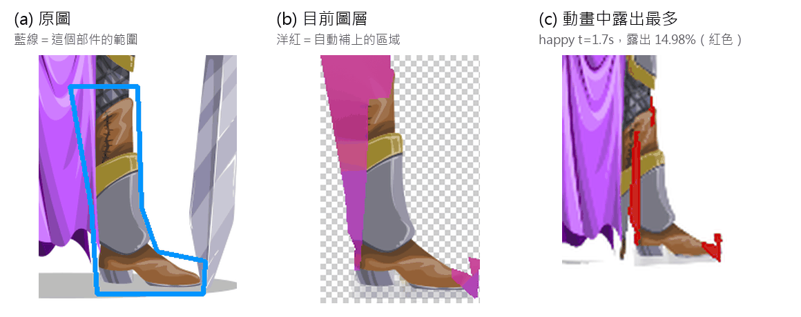
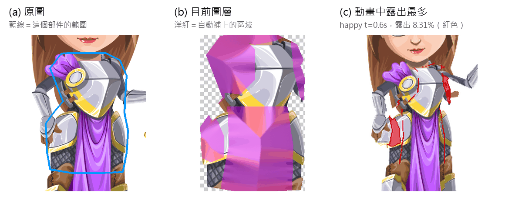
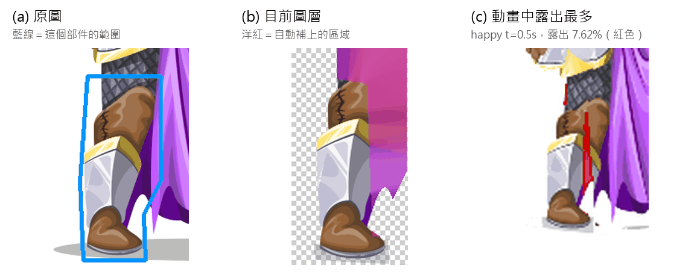
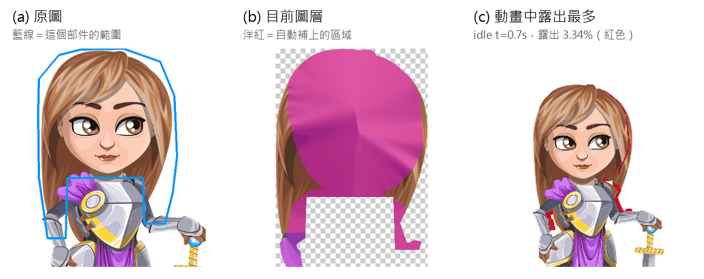
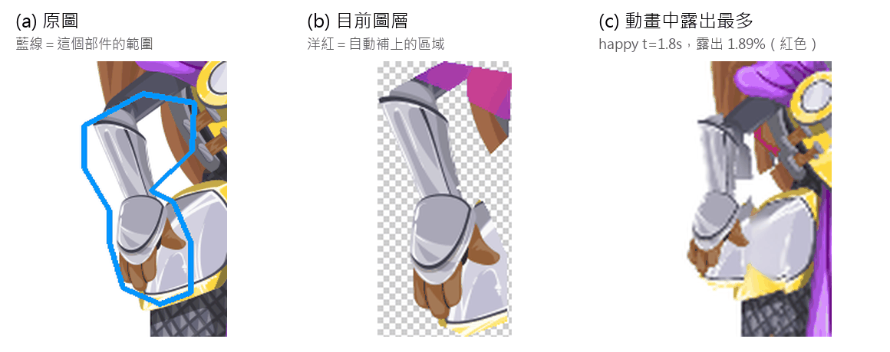
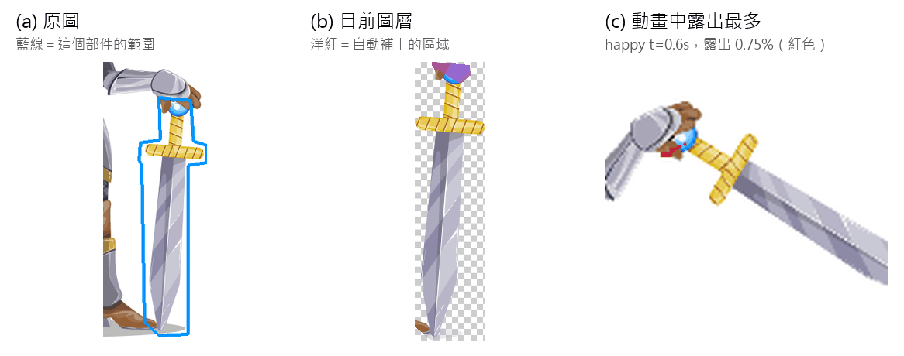
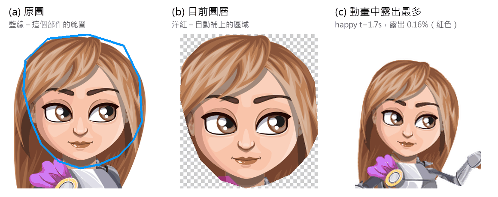

# 補畫優先順序：work

露出量是 Python Simulation Preview 的量測（非 Spine 算圖）：自動補上的像素在 idle／happy 中實際被看見的量，扣掉初始姿勢的值，除以部件在初始姿勢的面積。取樣：每 0.1 秒加上每個關鍵影格。
優先：高 ≥ 2%；中 0.5%–2%；低 > 0 且 < 0.5%（可保留草稿，目視確認即可）；無露出 = 0（動畫中不會露出，可保留草稿）。
像素是預覽畫布像素（縮放 0.379），括號內換算成原圖像素。

## 需要人工補畫（needs_manual）

| 順位 | 部件 | 優先 | 最大露出 | 露出像素 | 發生於 | hidden_ratio | holdout_error | contour_hidden | 遮擋者 |
|---|---|---|---|---|---|---|---|---|---|
| 1 | `leg_r` | 高 | 14.98% | 277（約 1924） | happy t=1.7s | 0.413 | 0.1077 | 0.4575 | body、tabard、sword |
| 2 | `body` | 高 | 8.31% | 732（約 5085） | happy t=0.6s | 0.6721 | 1.0 | 0.5026 | tabard、arm_l、head、pauldron_l、arm_r |
| 3 | `leg_l` | 高 | 7.62% | 171（約 1187） | happy t=0.5s | 0.4148 | 0.168 | 0.4052 | body、tabard |
| 4 | `hair_back` | 高 | 3.34% | 423（約 2940） | idle t=0.7s | 0.8276 | 1.0 | 0.4373 | body、arm_l、head、pauldron_l、arm_r |

### leg_r（高）

補畫被 body、tabard、sword 遮住的區域（約 41% 面積）；動畫中最多露出 14.98%（happy t=1.7s）。若暫不補，可降低 body、tabard、sword 的 motion（parts.json），讓遮擋者別移開那麼多。補畫時注意：被遮住的輪廓佔 46%，那段外形要看原圖重畫，自動補圖補不出來；紋理延伸誤差 0.1077，自動填色會糊，要手繪紋理。

### body（高）

補畫被 tabard、arm_l、head、pauldron_l、arm_r 遮住的區域（約 67% 面積）；動畫中最多露出 8.31%（happy t=0.6s）。若暫不補，可降低 tabard、arm_l、head、pauldron_l、arm_r 的 motion（parts.json），讓遮擋者別移開那麼多。補畫時注意：被遮住的輪廓佔 50%，那段外形要看原圖重畫，自動補圖補不出來；紋理延伸誤差 1.0，自動填色會糊，要手繪紋理。

### leg_l（高）

補畫被 body、tabard 遮住的區域（約 41% 面積）；動畫中最多露出 7.62%（happy t=0.5s）。若暫不補，可降低 body、tabard 的 motion（parts.json），讓遮擋者別移開那麼多。補畫時注意：被遮住的輪廓佔 41%，那段外形要看原圖重畫，自動補圖補不出來；紋理延伸誤差 0.168，自動填色會糊，要手繪紋理。

### hair_back（高）

補畫被 body、arm_l、head、pauldron_l、arm_r 遮住的區域（約 83% 面積）；動畫中最多露出 3.34%（idle t=0.7s）。若暫不補，可降低 body、arm_l、head、pauldron_l、arm_r 的 motion（parts.json），讓遮擋者別移開那麼多。補畫時注意：被遮住的輪廓佔 44%，那段外形要看原圖重畫，自動補圖補不出來；紋理延伸誤差 1.0，自動填色會糊，要手繪紋理。

## 自動補但不可靠

| 順位 | 部件 | 優先 | 最大露出 | 露出像素 | 發生於 | hidden_ratio | holdout_error | contour_hidden | 遮擋者 |
|---|---|---|---|---|---|---|---|---|---|
| 1 | `arm_l` | 中 | 1.89% | 26（約 180） | happy t=1.8s | 0.1314 | 0.1601 | 0.1604 | pauldron_l |
| 2 | `sword` | 中 | 0.75% | 15（約 102） | happy t=0.6s | 0.0573 | 0.2015 | 0.0797 | arm_r |
| 3 | `head` | 低 | 0.16% | 15（約 107） | happy t=1.7s | 0.0053 | 0.0861 | 0.0312 | pauldron_l |

### arm_l（中）

補畫被 pauldron_l 遮住的區域（約 13% 面積）；動畫中最多露出 1.89%（happy t=1.8s）。若暫不補，可降低 pauldron_l 的 motion（parts.json），讓遮擋者別移開那麼多。補畫時注意：紋理延伸誤差 0.1601，自動填色會糊，要手繪紋理。

### sword（中）

補畫被 arm_r 遮住的區域（約 6% 面積）；動畫中最多露出 0.75%（happy t=0.6s）。若暫不補，可降低 arm_r 的 motion（parts.json），讓遮擋者別移開那麼多。補畫時注意：紋理延伸誤差 0.2015，自動填色會糊，要手繪紋理。

### head（低）

補畫被 pauldron_l 遮住的區域（約 1% 面積）；動畫中最多露出 0.16%（happy t=1.7s）。可保留草稿，目視確認即可。補畫時注意：紋理延伸誤差 0.0861，自動填色會糊，要手繪紋理。

