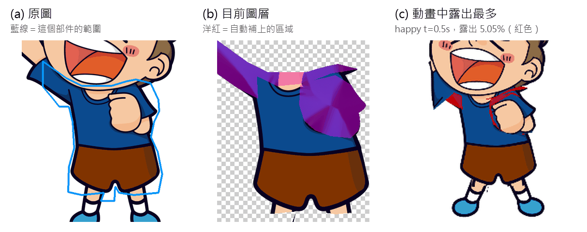
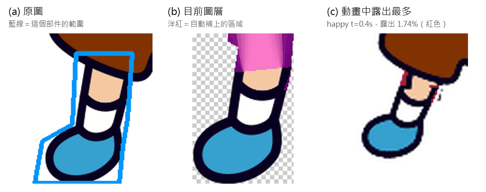
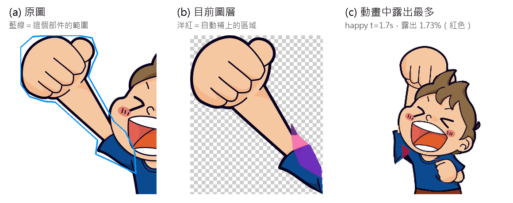
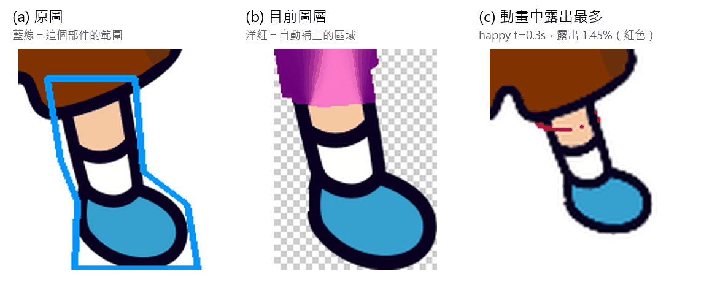
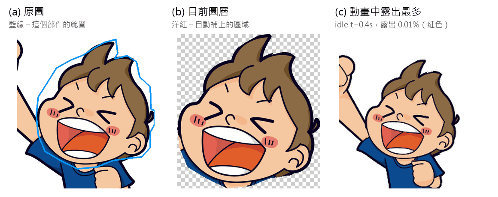

# 補畫優先順序：work

露出量是 Python Simulation Preview 的量測（非 Spine 算圖）：自動補上的像素在 idle／happy 中實際被看見的量，扣掉初始姿勢的值，除以部件在初始姿勢的面積。取樣：每 0.1 秒加上每個關鍵影格。
優先：高 ≥ 2%；中 0.5%–2%；低 > 0 且 < 0.5%（可保留草稿，目視確認即可）；無露出 = 0（動畫中不會露出，可保留草稿）。
像素是預覽畫布像素（縮放 0.375），括號內換算成原圖像素。

## 需要人工補畫（needs_manual）

| 順位 | 部件 | 優先 | 最大露出 | 露出像素 | 發生於 | hidden_ratio | holdout_error | contour_hidden | 遮擋者 |
|---|---|---|---|---|---|---|---|---|---|
| 1 | `body` | 高 | 5.05% | 479（約 3410） | happy t=0.5s | 0.3393 | 0.0909 | 0.299 | arm_l、head、arm_r |

### body（高）

補畫被 arm_l、head、arm_r 遮住的區域（約 34% 面積）；動畫中最多露出 5.05%（happy t=0.5s）。若暫不補，可降低 arm_l、head、arm_r 的 motion（parts.json），讓遮擋者別移開那麼多。補畫時注意：被遮住的輪廓佔 30%，那段外形要看原圖重畫，自動補圖補不出來；紋理延伸誤差 0.0909，自動填色會糊，要手繪紋理。

## 自動補但不可靠

| 順位 | 部件 | 優先 | 最大露出 | 露出像素 | 發生於 | hidden_ratio | holdout_error | contour_hidden | 遮擋者 |
|---|---|---|---|---|---|---|---|---|---|
| 1 | `leg_l` | 中 | 1.74% | 20（約 142） | happy t=0.4s | 0.2238 | 0.3965 | 0.2725 | body |
| 2 | `arm_l` | 中 | 1.73% | 166（約 1183） | happy t=1.7s | 0.0848 | 0.1222 | 0.1266 | head |
| 3 | `leg_r` | 中 | 1.45% | 17（約 121） | happy t=0.3s | 0.25 | 0.3493 | 0.2731 | body |
| 4 | `head` | 低 | 0.01% | 2（約 15） | idle t=0.4s | 0.0001 | 0.1444 | 0.0 | arm_r |

### leg_l（中）

補畫被 body 遮住的區域（約 22% 面積）；動畫中最多露出 1.74%（happy t=0.4s）。若暫不補，可降低 body 的 motion（parts.json），讓遮擋者別移開那麼多。補畫時注意：被遮住的輪廓佔 27%，那段外形要看原圖重畫，自動補圖補不出來；紋理延伸誤差 0.3965，自動填色會糊，要手繪紋理。

### arm_l（中）

補畫被 head 遮住的區域（約 8% 面積）；動畫中最多露出 1.73%（happy t=1.7s）。若暫不補，可降低 head 的 motion（parts.json），讓遮擋者別移開那麼多。補畫時注意：紋理延伸誤差 0.1222，自動填色會糊，要手繪紋理。

### leg_r（中）

補畫被 body 遮住的區域（約 25% 面積）；動畫中最多露出 1.45%（happy t=0.3s）。若暫不補，可降低 body 的 motion（parts.json），讓遮擋者別移開那麼多。補畫時注意：被遮住的輪廓佔 27%，那段外形要看原圖重畫，自動補圖補不出來；紋理延伸誤差 0.3493，自動填色會糊，要手繪紋理。

### head（低）

補畫被 arm_r 遮住的區域（約 0% 面積）；動畫中最多露出 0.01%（idle t=0.4s）。可保留草稿，目視確認即可。補畫時注意：紋理延伸誤差 0.1444，自動填色會糊，要手繪紋理。

