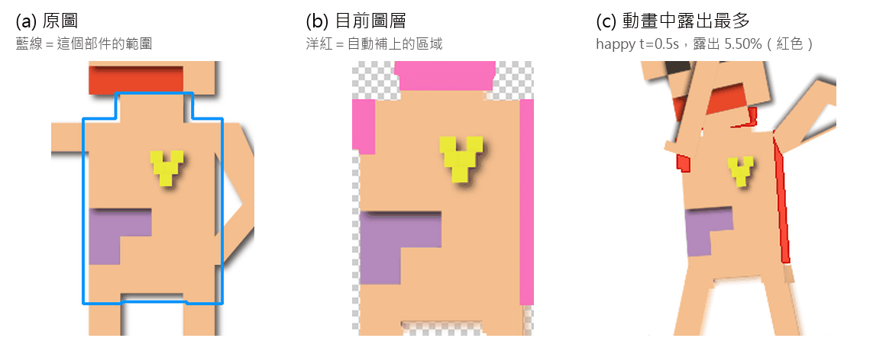

# 補畫優先順序：work

露出量是 Python Simulation Preview 的量測（非 Spine 算圖）：自動補上的像素在 idle／happy 中實際被看見的量，扣掉初始姿勢的值，除以部件在初始姿勢的面積。取樣：每 0.1 秒加上每個關鍵影格。
優先：高 ≥ 2%；中 0.5%–2%；低 > 0 且 < 0.5%（可保留草稿，目視確認即可）；無露出 = 0（動畫中不會露出，可保留草稿）。
像素是預覽畫布像素（縮放 0.680），括號內換算成原圖像素。

## 需要人工補畫（needs_manual）

| 順位 | 部件 | 優先 | 最大露出 | 露出像素 | 發生於 | hidden_ratio | holdout_error | contour_hidden | 遮擋者 |
|---|---|---|---|---|---|---|---|---|---|
| 1 | `body` | 高 | 5.50% | 684（約 1479） | happy t=0.5s | 0.1551 | 0.0043 | 0.4342 | head、arm_l、arm_r |

### body（高）

補畫被 head、arm_l、arm_r 遮住的區域（約 16% 面積）；動畫中最多露出 5.50%（happy t=0.5s）。若暫不補，可降低 head、arm_l、arm_r 的 motion（parts.json），讓遮擋者別移開那麼多。補畫時注意：被遮住的輪廓佔 43%，那段外形要看原圖重畫，自動補圖補不出來。

## 自動補但不可靠

（無）
