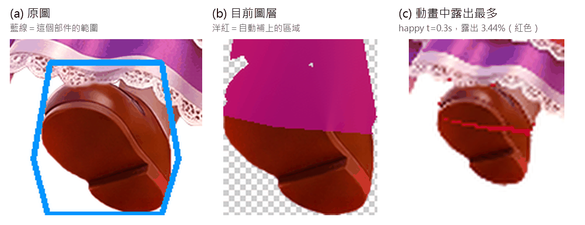
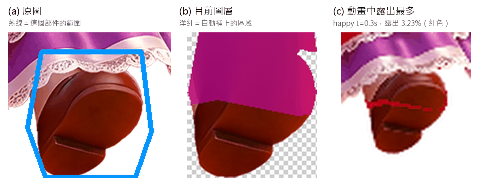
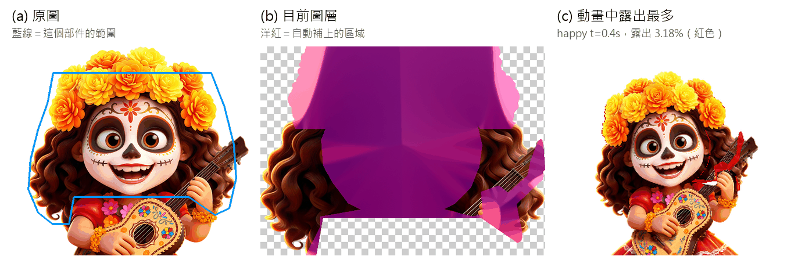
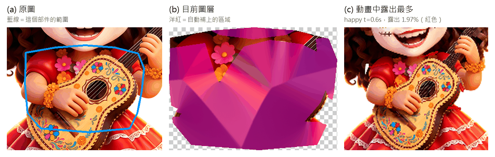
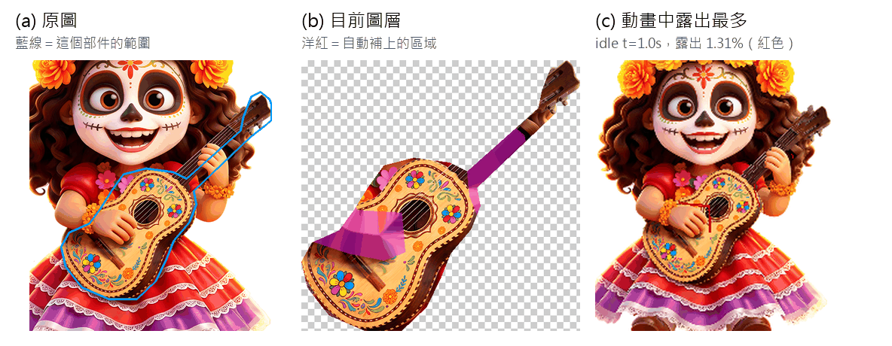
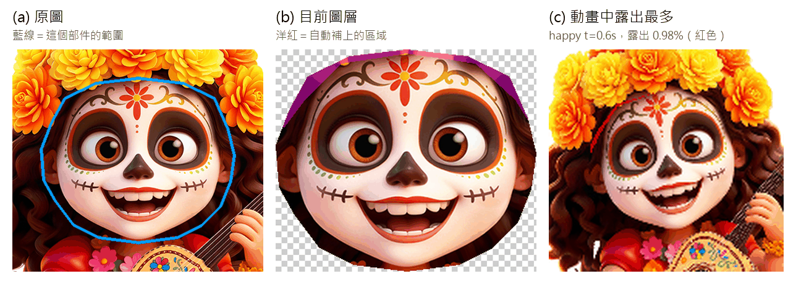
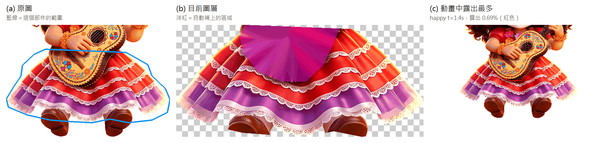

# 補畫優先順序：work

露出量是 Python Simulation Preview 的量測（非 Spine 算圖）：自動補上的像素在 idle／happy 中實際被看見的量，扣掉初始姿勢的值，除以部件在初始姿勢的面積。取樣：每 0.1 秒加上每個關鍵影格。
優先：高 ≥ 2%；中 0.5%–2%；低 > 0 且 < 0.5%（可保留草稿，目視確認即可）；無露出 = 0（動畫中不會露出，可保留草稿）。
像素是預覽畫布像素（縮放 0.338），括號內換算成原圖像素。

## 需要人工補畫（needs_manual）

| 順位 | 部件 | 優先 | 最大露出 | 露出像素 | 發生於 | hidden_ratio | holdout_error | contour_hidden | 遮擋者 |
|---|---|---|---|---|---|---|---|---|---|
| 1 | `leg_l` | 高 | 3.44% | 44（約 383） | happy t=0.3s | 0.5643 | 0.0436 | 0.5267 | skirt |
| 2 | `leg_r` | 高 | 3.23% | 42（約 368） | happy t=0.3s | 0.6002 | 0.0483 | 0.5478 | skirt |
| 3 | `hair_back` | 高 | 3.18% | 592（約 5173） | happy t=0.4s | 0.7514 | 1.0 | 0.5259 | body、head、flower_crown、guitar、arm_l、arm_r |
| 4 | `body` | 中 | 1.97% | 148（約 1294） | happy t=0.6s | 0.8716 | 1.0 | 0.6917 | skirt、head、guitar、arm_l、arm_r |

### leg_l（高）

補畫被 skirt 遮住的區域（約 56% 面積）；動畫中最多露出 3.44%（happy t=0.3s）。若暫不補，可降低 skirt 的 motion（parts.json），讓遮擋者別移開那麼多。補畫時注意：被遮住的輪廓佔 53%，那段外形要看原圖重畫，自動補圖補不出來。

### leg_r（高）

補畫被 skirt 遮住的區域（約 60% 面積）；動畫中最多露出 3.23%（happy t=0.3s）。若暫不補，可降低 skirt 的 motion（parts.json），讓遮擋者別移開那麼多。補畫時注意：被遮住的輪廓佔 55%，那段外形要看原圖重畫，自動補圖補不出來。

### hair_back（高）

補畫被 body、head、flower_crown、guitar、arm_l、arm_r 遮住的區域（約 75% 面積）；動畫中最多露出 3.18%（happy t=0.4s）。若暫不補，可降低 body、head、flower_crown、guitar、arm_l、arm_r 的 motion（parts.json），讓遮擋者別移開那麼多。補畫時注意：被遮住的輪廓佔 53%，那段外形要看原圖重畫，自動補圖補不出來；紋理延伸誤差 1.0，自動填色會糊，要手繪紋理。

### body（中）

補畫被 skirt、head、guitar、arm_l、arm_r 遮住的區域（約 87% 面積）；動畫中最多露出 1.97%（happy t=0.6s）。若暫不補，可降低 skirt、head、guitar、arm_l、arm_r 的 motion（parts.json），讓遮擋者別移開那麼多。補畫時注意：被遮住的輪廓佔 69%，那段外形要看原圖重畫，自動補圖補不出來；紋理延伸誤差 1.0，自動填色會糊，要手繪紋理。

## 自動補但不可靠

| 順位 | 部件 | 優先 | 最大露出 | 露出像素 | 發生於 | hidden_ratio | holdout_error | contour_hidden | 遮擋者 |
|---|---|---|---|---|---|---|---|---|---|
| 1 | `guitar` | 中 | 1.31% | 96（約 839） | idle t=1.0s | 0.1976 | 0.1906 | 0.2279 | arm_l、arm_r |
| 2 | `head` | 中 | 0.98% | 74（約 648） | happy t=0.6s | 0.0425 | 0.112 | 0.3101 | flower_crown |
| 3 | `skirt` | 中 | 0.69% | 99（約 867） | happy t=1.4s | 0.2144 | 0.2373 | 0.1069 | guitar、arm_l |

### guitar（中）

補畫被 arm_l、arm_r 遮住的區域（約 20% 面積）；動畫中最多露出 1.31%（idle t=1.0s）。若暫不補，可降低 arm_l、arm_r 的 motion（parts.json），讓遮擋者別移開那麼多。補畫時注意：紋理延伸誤差 0.1906，自動填色會糊，要手繪紋理。

### head（中）

補畫被 flower_crown 遮住的區域（約 4% 面積）；動畫中最多露出 0.98%（happy t=0.6s）。若暫不補，可降低 flower_crown 的 motion（parts.json），讓遮擋者別移開那麼多。補畫時注意：被遮住的輪廓佔 31%，那段外形要看原圖重畫，自動補圖補不出來；紋理延伸誤差 0.112，自動填色會糊，要手繪紋理。

### skirt（中）

補畫被 guitar、arm_l 遮住的區域（約 21% 面積）；動畫中最多露出 0.69%（happy t=1.4s）。若暫不補，可降低 guitar、arm_l 的 motion（parts.json），讓遮擋者別移開那麼多。補畫時注意：紋理延伸誤差 0.2373，自動填色會糊，要手繪紋理。

