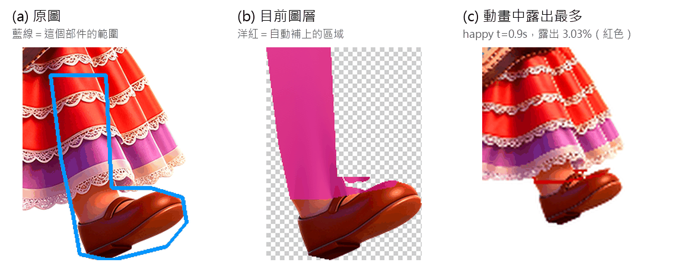
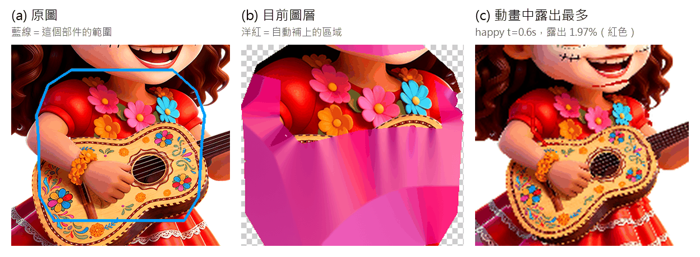
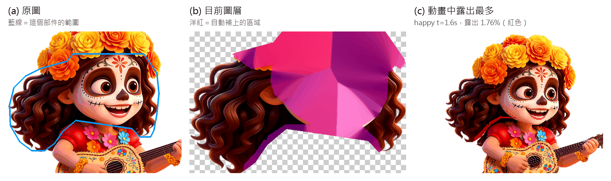
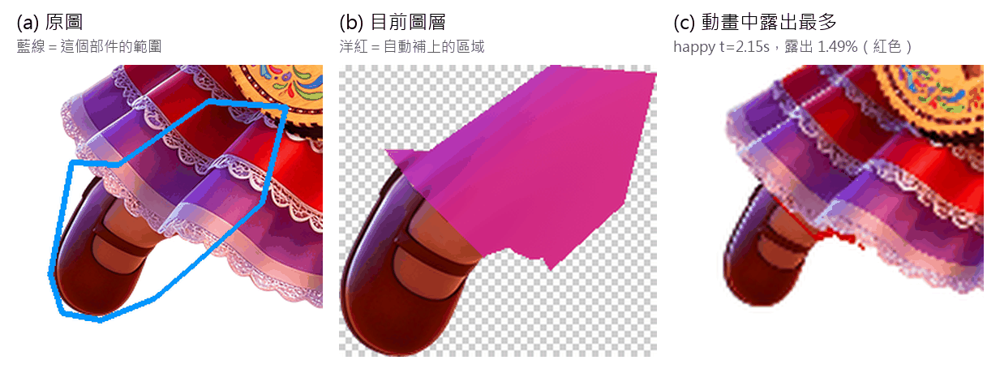
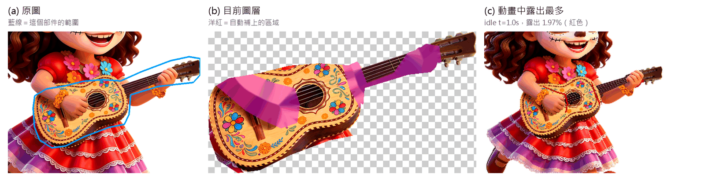
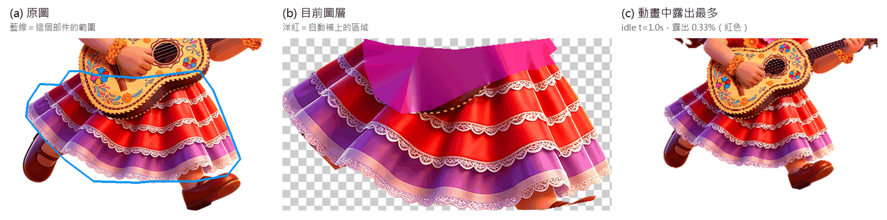

# 補畫優先順序：work

露出量是 Python Simulation Preview 的量測（非 Spine 算圖）：自動補上的像素在 idle／happy 中實際被看見的量，扣掉初始姿勢的值，除以部件在初始姿勢的面積。取樣：每 0.1 秒加上每個關鍵影格。
優先：高 ≥ 2%；中 0.5%–2%；低 > 0 且 < 0.5%（可保留草稿，目視確認即可）；無露出 = 0（動畫中不會露出，可保留草稿）。
像素是預覽畫布像素（縮放 0.342），括號內換算成原圖像素。

## 需要人工補畫（needs_manual）

| 順位 | 部件 | 優先 | 最大露出 | 露出像素 | 發生於 | hidden_ratio | holdout_error | contour_hidden | 遮擋者 |
|---|---|---|---|---|---|---|---|---|---|
| 1 | `leg_r` | 高 | 3.03% | 65（約 561） | happy t=0.9s | 0.6088 | 1.0 | 0.5985 | skirt |
| 2 | `body` | 中 | 1.97% | 159（約 1362） | happy t=0.6s | 0.663 | 1.0 | 0.6844 | head、guitar、arm_l、arm_r |
| 3 | `hair_back` | 中 | 1.76% | 233（約 2000） | happy t=1.6s | 0.5813 | 1.0 | 0.4015 | body、head、arm_l、arm_r |
| 4 | `leg_l` | 中 | 1.49% | 32（約 278） | happy t=2.15s | 0.6576 | 0.1328 | 0.5793 | skirt、guitar |

### leg_r（高）

補畫被 skirt 遮住的區域（約 61% 面積）；動畫中最多露出 3.03%（happy t=0.9s）。若暫不補，可降低 skirt 的 motion（parts.json），讓遮擋者別移開那麼多。補畫時注意：被遮住的輪廓佔 60%，那段外形要看原圖重畫，自動補圖補不出來；紋理延伸誤差 1.0，自動填色會糊，要手繪紋理。

### body（中）

補畫被 head、guitar、arm_l、arm_r 遮住的區域（約 66% 面積）；動畫中最多露出 1.97%（happy t=0.6s）。若暫不補，可降低 head、guitar、arm_l、arm_r 的 motion（parts.json），讓遮擋者別移開那麼多。補畫時注意：被遮住的輪廓佔 68%，那段外形要看原圖重畫，自動補圖補不出來；紋理延伸誤差 1.0，自動填色會糊，要手繪紋理。

### hair_back（中）

補畫被 body、head、arm_l、arm_r 遮住的區域（約 58% 面積）；動畫中最多露出 1.76%（happy t=1.6s）。若暫不補，可降低 body、head、arm_l、arm_r 的 motion（parts.json），讓遮擋者別移開那麼多。補畫時注意：被遮住的輪廓佔 40%，那段外形要看原圖重畫，自動補圖補不出來；紋理延伸誤差 1.0，自動填色會糊，要手繪紋理。

### leg_l（中）

補畫被 skirt、guitar 遮住的區域（約 66% 面積）；動畫中最多露出 1.49%（happy t=2.15s）。若暫不補，可降低 skirt、guitar 的 motion（parts.json），讓遮擋者別移開那麼多。補畫時注意：被遮住的輪廓佔 58%，那段外形要看原圖重畫，自動補圖補不出來；紋理延伸誤差 0.1328，自動填色會糊，要手繪紋理。

## 自動補但不可靠

| 順位 | 部件 | 優先 | 最大露出 | 露出像素 | 發生於 | hidden_ratio | holdout_error | contour_hidden | 遮擋者 |
|---|---|---|---|---|---|---|---|---|---|
| 1 | `guitar` | 中 | 1.97% | 144（約 1231） | idle t=1.0s | 0.2862 | 0.2251 | 0.1889 | arm_l、arm_r |
| 2 | `skirt` | 低 | 0.33% | 36（約 311） | idle t=1.0s | 0.2104 | 0.178 | 0.209 | body、guitar、arm_l |

### guitar（中）

補畫被 arm_l、arm_r 遮住的區域（約 29% 面積）；動畫中最多露出 1.97%（idle t=1.0s）。若暫不補，可降低 arm_l、arm_r 的 motion（parts.json），讓遮擋者別移開那麼多。補畫時注意：紋理延伸誤差 0.2251，自動填色會糊，要手繪紋理。

### skirt（低）

補畫被 body、guitar、arm_l 遮住的區域（約 21% 面積）；動畫中最多露出 0.33%（idle t=1.0s）。可保留草稿，目視確認即可。補畫時注意：紋理延伸誤差 0.178，自動填色會糊，要手繪紋理。

