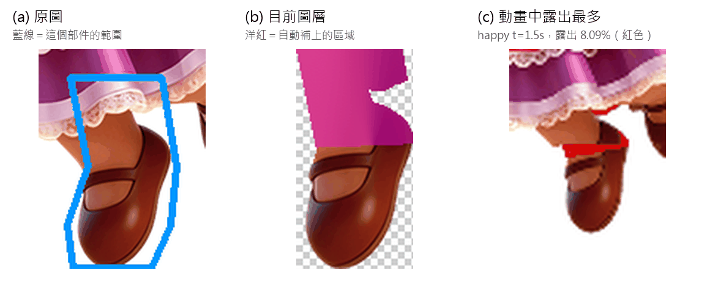
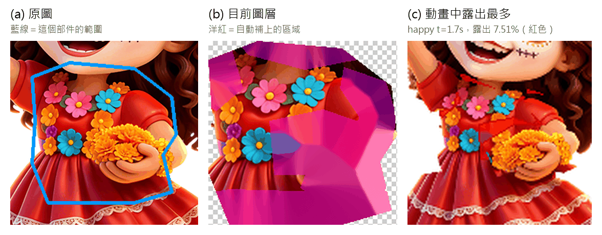
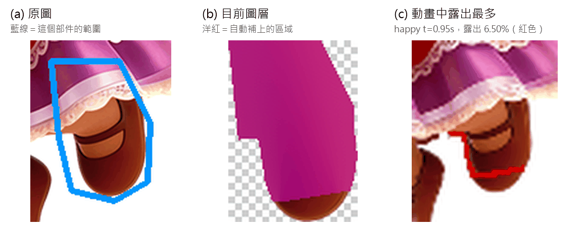
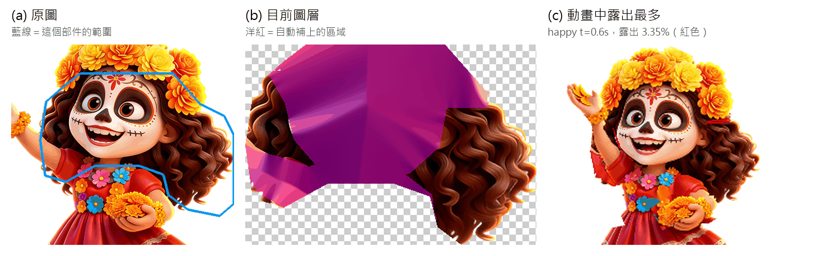
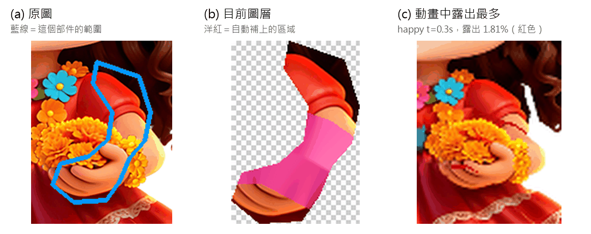

# 補畫優先順序：work

露出量是 Python Simulation Preview 的量測（非 Spine 算圖）：自動補上的像素在 idle／happy 中實際被看見的量，扣掉初始姿勢的值，除以部件在初始姿勢的面積。取樣：每 0.1 秒加上每個關鍵影格。
優先：高 ≥ 2%；中 0.5%–2%；低 > 0 且 < 0.5%（可保留草稿，目視確認即可）；無露出 = 0（動畫中不會露出，可保留草稿）。
像素是預覽畫布像素（縮放 0.412），括號內換算成原圖像素。

## 需要人工補畫（needs_manual）

| 順位 | 部件 | 優先 | 最大露出 | 露出像素 | 發生於 | hidden_ratio | holdout_error | contour_hidden | 遮擋者 |
|---|---|---|---|---|---|---|---|---|---|
| 1 | `leg_l` | 高 | 8.09% | 90（約 529） | happy t=1.5s | 0.4768 | 0.1059 | 0.5043 | skirt |
| 2 | `body` | 高 | 7.51% | 434（約 2551） | happy t=1.7s | 0.6297 | 1.0 | 0.6151 | skirt、head、arm_r、bouquet、arm_l |
| 3 | `leg_r` | 高 | 6.50% | 67（約 397） | happy t=0.95s | 0.9224 | 1.0 | 0.7658 | skirt |
| 4 | `hair_back` | 高 | 3.35% | 415（約 2443） | happy t=0.6s | 0.6383 | 1.0 | 0.3969 | body、head、arm_r、arm_l |
| 5 | `arm_r` | 中 | 1.81% | 21（約 125） | happy t=0.3s | 0.4273 | 0.2391 | 0.3377 | bouquet |

### leg_l（高）

補畫被 skirt 遮住的區域（約 48% 面積）；動畫中最多露出 8.09%（happy t=1.5s）。若暫不補，可降低 skirt 的 motion（parts.json），讓遮擋者別移開那麼多。補畫時注意：被遮住的輪廓佔 50%，那段外形要看原圖重畫，自動補圖補不出來；紋理延伸誤差 0.1059，自動填色會糊，要手繪紋理。

### body（高）

補畫被 skirt、head、arm_r、bouquet、arm_l 遮住的區域（約 63% 面積）；動畫中最多露出 7.51%（happy t=1.7s）。若暫不補，可降低 skirt、head、arm_r、bouquet、arm_l 的 motion（parts.json），讓遮擋者別移開那麼多。補畫時注意：被遮住的輪廓佔 62%，那段外形要看原圖重畫，自動補圖補不出來；紋理延伸誤差 1.0，自動填色會糊，要手繪紋理。

### leg_r（高）

補畫被 skirt 遮住的區域（約 92% 面積）；動畫中最多露出 6.50%（happy t=0.95s）。若暫不補，可降低 skirt 的 motion（parts.json），讓遮擋者別移開那麼多。補畫時注意：被遮住的輪廓佔 77%，那段外形要看原圖重畫，自動補圖補不出來；紋理延伸誤差 1.0，自動填色會糊，要手繪紋理。

### hair_back（高）

補畫被 body、head、arm_r、arm_l 遮住的區域（約 64% 面積）；動畫中最多露出 3.35%（happy t=0.6s）。若暫不補，可降低 body、head、arm_r、arm_l 的 motion（parts.json），讓遮擋者別移開那麼多。補畫時注意：被遮住的輪廓佔 40%，那段外形要看原圖重畫，自動補圖補不出來；紋理延伸誤差 1.0，自動填色會糊，要手繪紋理。

### arm_r（中）

補畫被 bouquet 遮住的區域（約 43% 面積）；動畫中最多露出 1.81%（happy t=0.3s）。若暫不補，可降低 bouquet 的 motion（parts.json），讓遮擋者別移開那麼多。補畫時注意：被遮住的輪廓佔 34%，那段外形要看原圖重畫，自動補圖補不出來；紋理延伸誤差 0.2391，自動填色會糊，要手繪紋理。

## 自動補但不可靠

（無）
