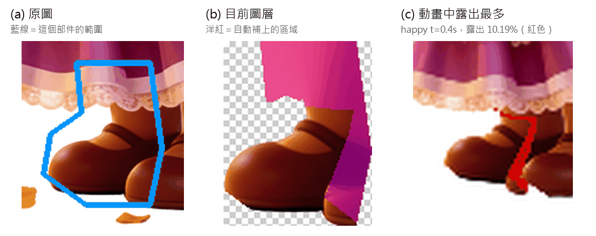
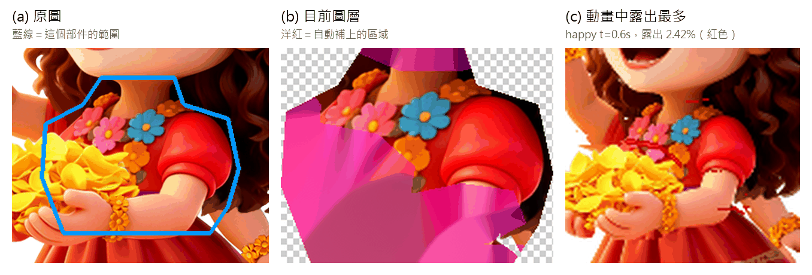
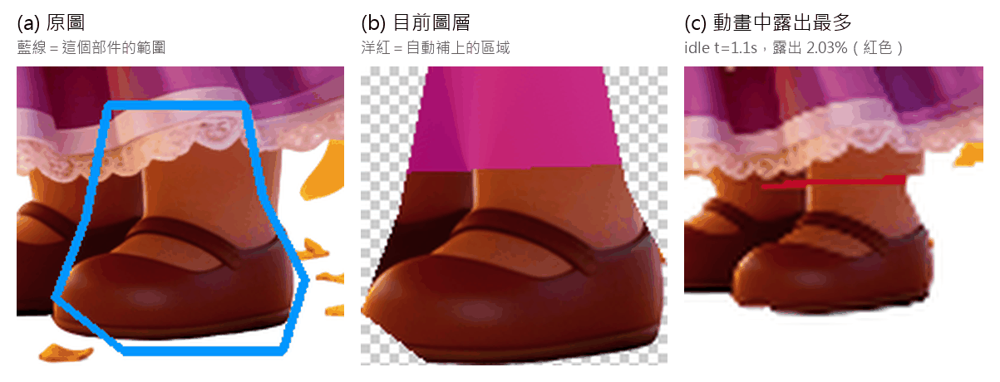
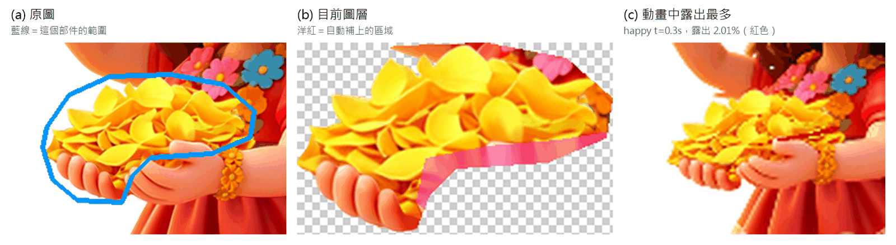
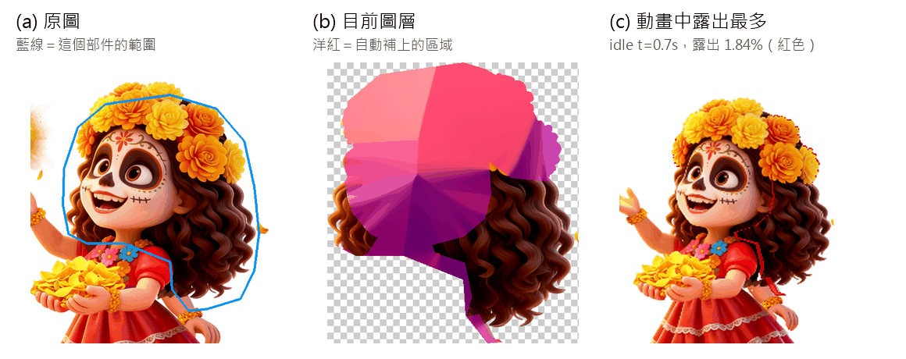
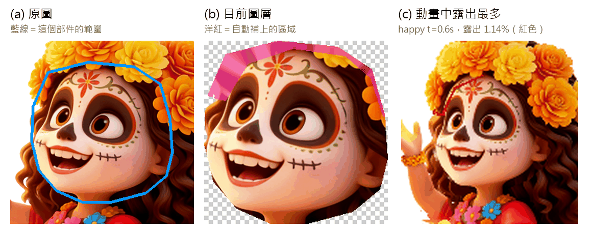
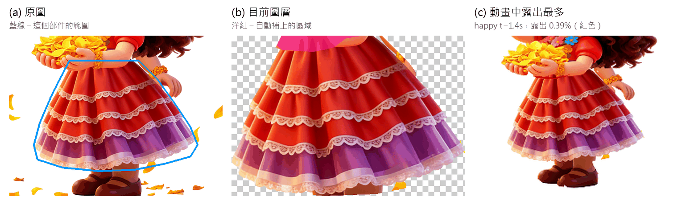

# 補畫優先順序：work

露出量是 Python Simulation Preview 的量測（非 Spine 算圖）：自動補上的像素在 idle／happy 中實際被看見的量，扣掉初始姿勢的值，除以部件在初始姿勢的面積。取樣：每 0.1 秒加上每個關鍵影格。
優先：高 ≥ 2%；中 0.5%–2%；低 > 0 且 < 0.5%（可保留草稿，目視確認即可）；無露出 = 0（動畫中不會露出，可保留草稿）。
像素是預覽畫布像素（縮放 0.348），括號內換算成原圖像素。

## 需要人工補畫（needs_manual）

| 順位 | 部件 | 優先 | 最大露出 | 露出像素 | 發生於 | hidden_ratio | holdout_error | contour_hidden | 遮擋者 |
|---|---|---|---|---|---|---|---|---|---|
| 1 | `leg_l` | 高 | 10.19% | 97（約 796） | happy t=0.4s | 0.498 | 0.0824 | 0.496 | leg_r、skirt |
| 2 | `body` | 高 | 2.42% | 93（約 766） | happy t=0.6s | 0.5541 | 1.0 | 0.5332 | skirt、head、arm_l、petals、arm_r |
| 3 | `leg_r` | 高 | 2.03% | 30（約 247） | idle t=1.1s | 0.2825 | 0.0891 | 0.3221 | skirt |
| 4 | `petals` | 高 | 2.01% | 37（約 305） | happy t=0.3s | 0.1073 | 0.0903 | 0.2021 | arm_r |
| 5 | `hair_back` | 中 | 1.84% | 282（約 2324） | idle t=0.7s | 0.6775 | 1.0 | 0.3909 | arm_extra、body、head、flower_crown、arm_l |

### leg_l（高）

補畫被 leg_r、skirt 遮住的區域（約 50% 面積）；動畫中最多露出 10.19%（happy t=0.4s）。若暫不補，可降低 leg_r、skirt 的 motion（parts.json），讓遮擋者別移開那麼多。補畫時注意：被遮住的輪廓佔 50%，那段外形要看原圖重畫，自動補圖補不出來；紋理延伸誤差 0.0824，自動填色會糊，要手繪紋理。

### body（高）

補畫被 skirt、head、arm_l、petals、arm_r 遮住的區域（約 55% 面積）；動畫中最多露出 2.42%（happy t=0.6s）。若暫不補，可降低 skirt、head、arm_l、petals、arm_r 的 motion（parts.json），讓遮擋者別移開那麼多。補畫時注意：被遮住的輪廓佔 53%，那段外形要看原圖重畫，自動補圖補不出來；紋理延伸誤差 1.0，自動填色會糊，要手繪紋理。

### leg_r（高）

補畫被 skirt 遮住的區域（約 28% 面積）；動畫中最多露出 2.03%（idle t=1.1s）。若暫不補，可降低 skirt 的 motion（parts.json），讓遮擋者別移開那麼多。補畫時注意：被遮住的輪廓佔 32%，那段外形要看原圖重畫，自動補圖補不出來；紋理延伸誤差 0.0891，自動填色會糊，要手繪紋理。

### petals（高）

補畫被 arm_r 遮住的區域（約 11% 面積）；動畫中最多露出 2.01%（happy t=0.3s）。若暫不補，可降低 arm_r 的 motion（parts.json），讓遮擋者別移開那麼多。補畫時注意：紋理延伸誤差 0.0903，自動填色會糊，要手繪紋理。

### hair_back（中）

補畫被 arm_extra、body、head、flower_crown、arm_l 遮住的區域（約 68% 面積）；動畫中最多露出 1.84%（idle t=0.7s）。若暫不補，可降低 arm_extra、body、head、flower_crown、arm_l 的 motion（parts.json），讓遮擋者別移開那麼多。補畫時注意：被遮住的輪廓佔 39%，那段外形要看原圖重畫，自動補圖補不出來；紋理延伸誤差 1.0，自動填色會糊，要手繪紋理。

## 自動補但不可靠

| 順位 | 部件 | 優先 | 最大露出 | 露出像素 | 發生於 | hidden_ratio | holdout_error | contour_hidden | 遮擋者 |
|---|---|---|---|---|---|---|---|---|---|
| 1 | `head` | 中 | 1.14% | 69（約 568） | happy t=0.6s | 0.0883 | 0.1519 | 0.3257 | flower_crown |
| 2 | `skirt` | 低 | 0.39% | 47（約 384） | happy t=1.4s | 0.0336 | 0.0848 | 0.0828 | arm_r |

### head（中）

補畫被 flower_crown 遮住的區域（約 9% 面積）；動畫中最多露出 1.14%（happy t=0.6s）。若暫不補，可降低 flower_crown 的 motion（parts.json），讓遮擋者別移開那麼多。補畫時注意：被遮住的輪廓佔 33%，那段外形要看原圖重畫，自動補圖補不出來；紋理延伸誤差 0.1519，自動填色會糊，要手繪紋理。

### skirt（低）

補畫被 arm_r 遮住的區域（約 3% 面積）；動畫中最多露出 0.39%（happy t=1.4s）。可保留草稿，目視確認即可。補畫時注意：紋理延伸誤差 0.0848，自動填色會糊，要手繪紋理。

